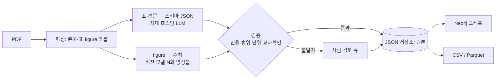
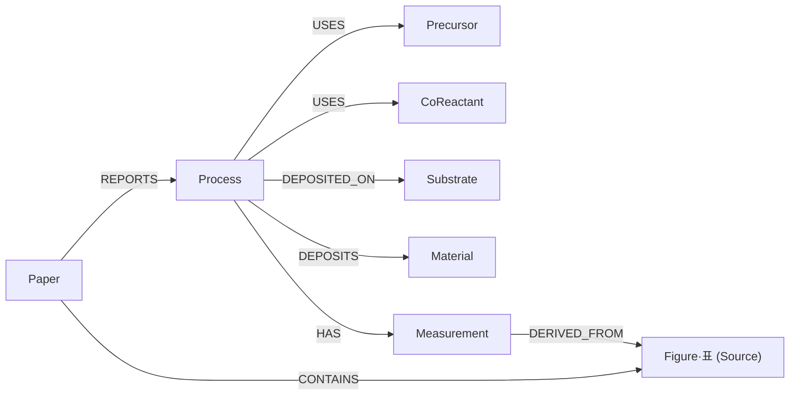

# ALD 논문 데이터 추출·데이터베이스 구축 보고서

2026-11-04 · 본아

## 요약과 결론

**가능합니다.** 병목은 데이터베이스가 아니라 추출 정확도와 이름·단위 정규화입니다. 논문 수백~수천 편의 저장·질의 부하는 개인 데스크톱에서도 크지 않을 것으로 보입니다(추정).

ALD 논문 전용으로 표·figure·실험 데이터를 한 번에 뽑는 모델은 이번 조사에서 찾지 못했습니다. 대신 아래 조합을 권장합니다. 자체 호스팅 LLM과 외부 API LLM 두 방식으로 나눠 정리했고, 자체 호스팅 모델의 이미지 입력 지원 여부가 figure 처리 방식을 가르며, 텍스트 전용이어도 자체 호스팅 비전 모델로 figure를 처리할 수 있습니다.

- **파싱:** PaddleOCR-VL-1.6(OmniDocBench v1.6 96.34) 또는 MinerU2.5-Pro(95.75)로 본문·표·수식·figure 크롭을 뽑습니다.
- **Figure 수치:** 범용 VLM(Qwen3-VL 계열)으로 같은 차트를 여러 번 추출해 앙상블하고, 핵심 그래프는 WebPlotDigitizer로 수동 확인합니다.
- **스키마:** Schema-Miner의 ALD 실험 스키마를 참고해 Pydantic 스키마를 만듭니다.
- **저장:** 검증된 JSON을 원본으로 두고, Neo4j 그래프와 ML용 표는 JSON에서 만든 파생 뷰로 둡니다.
- **검증:** 직접 라벨링한 논문 20편 정답셋으로 필드별 정확도를 측정합니다.

핵심 위험은 세 가지입니다. 전구체·기판 이름의 표기 불일치, 어려운 표에서의 정확도 하락, figure 수치의 낮은 신뢰도입니다.

## 조사 결과: 모델과 도구 비교

문서 파싱은 1B급 전용 모델이 큰 범용 VLM을 앞서고, figure 수치 추출은 범용 VLM이 전용 모델 DePlot을 앞섭니다. 아래 점수는 각 프로젝트와 비교 글이 보고한 값이며 직접 재현한 것이 아닙니다.

| 용도 | 모델·도구 | 핵심 수치 | 비고 |
|---|---|---|---|
| 문서 파싱 | [PaddleOCR-VL-1.6](https://roboflow.com/blog/best-open-source-ocr-models) (0.9B) | OmniDocBench v1.6 96.34, 표 TEDS 94.76 | Apache 2.0, FP16 VRAM 약 2GB |
| 문서 파싱 | [MinerU2.5-Pro](https://huggingface.co/opendatalab/MinerU2.5-Pro-2605-1.2B) (1.2B) | 95.75, 표 TEDS 93.42 | 가중치는 조건부 Apache 2.0 |
| 문서 파싱 | [GLM-OCR](https://roboflow.com/blog/best-open-source-ocr-models) | 95.22 | 0.9B급 |
| 문서 파싱 | [TeleOCR](https://huggingface.co/StarDoc-AI/TeleOCR) (약 1.2B) | 한 비교 글에서 96.91 | 2026-08 공개, 신생 |
| 문서 파싱 | dots.ocr (3B) | 약 90.8, 표 TEDS 87.18 | MIT |
| 문서 파싱 | olmOCR 2 (7B) | 약 85.7, 표 TEDS 83.00 | Apache 2.0 |
| 파이프라인 | [Docling](https://github.com/docling-project) | 스타 약 45.3k, 레이아웃·읽기 순서·표 구조 | MIT, VLM 파이프라인 선택 가능 |
| Figure → 표 | 범용 VLM (Qwen3-VL 등) | [PlotPick](https://arxiv.org/html/2605.06021v2) 평가에서 ChartX 전체 합산 기준 DePlot보다 높음 | 유형별 편차 있음 |
| Figure → 표 | DePlot (282M) | 전용 chart-to-table | 상자그림 등 일부 유형 약함 |
| Figure 수동 | [WebPlotDigitizer](https://github.com/automeris-io/WebPlotDigitizer) | 스타 약 3.1k | AGPL, 수동 보정 기반 |
| Figure 보조 | [figrecover](https://pypi.org/project/figrecover/) | 근사치 복원 | 알파, 결과 검토 필수 |
| 표 → 구조화 | [MaTableGPT](https://arxiv.org/pdf/2406.05431) | 수전해 촉매 문헌에서 F1 최대 96.8% | 재료과학 표 전용 |
| 문서 → 그래프 | [docling-graph](https://github.com/docling-project/docling-graph) | 스타 약 756 | MIT, CSV·Cypher 내보내기 |

주의: 한 비교 글은 다른 평가 조건에서 초기 PaddleOCR-VL이 91.93에서 72.19로, MinerU2.5가 90.67에서 70.91로 떨어졌다고 보고합니다. ALD 논문의 첨자·화학식 표로 직접 비교 테스트가 필요합니다.

## ALD 특화 선행 연구

ALD 분야에는 추출 모델은 없지만 스키마와 LLM 파이프라인 수준의 선행 연구가 있어, 스키마를 처음부터 만들 필요가 없습니다.

- **[Schema-Miner](https://research.tue.nl/en/datasets/atomic-layer-deposition-and-etching-process-schemas-extracted-wit/)****:** LLM과 전문가 검토로 만든 ALD/ALE 공정 스키마가 공개돼 있고, 실험용과 시뮬레이션용으로 나뉩니다. 최신 버전은 슈퍼 사이클(IGZO 예시)을 지원하며, 구성 화합물별 growth per cycle, 사이클 수, 총 두께, 반응물 유량, 특성값별 측정 기법을 담습니다.
- **단위 표준화:** 물리량에 QUDT 온톨로지를 붙여 quantityKind, unit, quantityValue를 분리해 저장합니다. 단위 정규화에 그대로 참고할 수 있습니다.
- **[ORKG 사례](https://web3.arxiv.org/pdf/2601.05051)****:** ALD/ALE 리뷰 논문의 표를 기계가 읽을 수 있는 비교표로 게시한 연구입니다. LLM으로 PDF를 직접 질의하면 같은 질문에도 실행마다 답이 달라질 수 있으므로, 공정 창과 growth per cycle처럼 정확한 수치가 필요한 질의에는 구조화 데이터가 낫다고 지적합니다.
- **[ChatGPT-4 워크숍](https://www.atomiclimits.com/2024/04/09/ai-serving-the-ald-community-using-chatgpt-4-to-extract-ald-parameters-from-scientific-papers)****:** 재료, 전구체, 두께, growth per cycle, 온도 범위 5개 항목을 프롬프트로 뽑아 본 시도입니다. 전수 정확도 평가는 확인하지 못했습니다.

이 스키마의 슈퍼 사이클 구조는 [In–As]×m + [Ga–As]×n 계획에 맞게 확장할 수 있어 보입니다. 필드 정의는 직접 확인이 필요합니다.

## 추출 파이프라인

표·본문과 figure는 따로 처리하고, 두 결과 모두 검증을 통과한 값만 저장합니다.

*추출 파이프라인 개요 (원본 문서의 다이어그램을 간략히 다시 그린 것입니다).*

- **표·본문:** 표 HTML과 본문을 Pydantic 스키마에 매핑하고, 값마다 출처 페이지·원문 문장·추출 방식을 붙입니다.
- **Figure:** 차트 유형을 분류하고 VLM으로 N회 추출해 정렬·병합합니다. 추출마다 값이 크게 갈리면 낮은 신뢰도로 표시합니다.
- **검증:** 본문·표의 같은 수치와 대조하고, 단위와 값 범위를 검사합니다.
- **불일치:** 사람이 확인·수정한 뒤에만 저장합니다.

## 방식 A: 자체 호스팅 LLM으로 구현

표·본문 처리는 자체 호스팅 LLM으로 가능하고, figure 처리는 자체 호스팅 모델이 이미지를 받는지에 따라 갈립니다. 서버에 어떤 DeepSeek 변종이 올라가 있는지 먼저 확인해야 합니다.

| 모델 | 이미지 입력 | 비고 |
|---|---|---|
| [deepseek-v4-pro](https://api-docs.deepseek.com/news/news260424) | [텍스트만](https://openrouter.ai/blog/insights/deepseek-v4-vision/) | 1.6T 파라미터(활성 49B), 컨텍스트 1M |
| [deepseek-v4-flash](https://api-docs.deepseek.com/news/news260424) | [텍스트만](https://openrouter.ai/blog/insights/deepseek-v4-vision/) | 284B(활성 13B), 컨텍스트 1M |
| [deepseek-v4-flash-vision-exp](https://note.com/ai_driven/n/n206d96eeed94?hl=en) | 가능(실험) | 2026-08-21 API 공개 |
| [deepseek-v4.1-flash](https://build.nvidia.com/deepseek-ai/deepseek-v4.1-flash/modelcard) | 가능 | 멀티모달 MoE, 컨텍스트 최대 1M, 이미지 토큰 최대 1,024 |

> [다이어그램] 방식 A 분기(이미지 입력 테스트 → 분기 2개)는 위 표와 본문에 글로 정리되어 있으며, 도식은 원본 Claude Docs 문서에 있습니다.

먼저 차트 이미지 한 장을 자체 호스팅 모델에 보내 입력 가능 여부를 확인합니다. 텍스트 전용이면 자체 호스팅 비전 모델이 figure를 표로 바꾸고 DeepSeek은 텍스트만 받습니다. 이미지를 텍스트로 바꿔 텍스트 모델에 넘기는 우회는 [DeepSeek 커뮤니티에서도 쓰이며](https://github.com/deepseek-ai/deepseek-harness/discussions/3512), 비전 결과는 검증 전까지 파생 증거로만 다뤄야 합니다.

- **파싱:** 로컬 전용 모델(PaddleOCR-VL-1.6, MinerU2.5-Pro), 자체 호스팅 비전 모델(표 판독 정확도는 비교 측정 필요) 또는 [DeepSeek-OCR-2](https://pypi.org/project/memect-ppx/0.0.2/)를 씁니다. DeepSeek-OCR-2는 약 3B 규모이고 vLLM 서빙에 VRAM 약 20GB가 안내됩니다. 라이선스는 자료마다 표기가 달라 확인이 필요합니다.
- **표·본문 → 스키마:** 자체 호스팅 LLM이 맡습니다. 컨텍스트가 1M이라 논문 전문과 표 HTML을 한 번에 넣어 본문과 표를 교차 참조시킬 수 있습니다. 출력은 JSON으로 받아 Pydantic으로 검증합니다.
- **Figure:** 위 분기대로 처리하고, 어느 쪽이든 앙상블과 표·본문 대조를 거칩니다.
- **호출 방식:** DeepSeek API는 OpenAI ChatCompletions와 Anthropic API 형식을 지원합니다. 엔드포인트가 같은 형식인지 확인합니다.
- **장점:** 자체 호스팅이라면 논문과 추출 결과가 외부로 나가지 않고, 컨텍스트 제약이 거의 없습니다.
- **한계:** 텍스트 전용이면 figure 정확도는 자체 호스팅 비전 모델에 달려 있고, 이 모델의 차트 수치 추출 정확도는 확인하지 못했습니다. Vision-Exp는 실험 단계입니다. 자체 호스팅 모델의 추출 정확도는 이번 조사에서 근거를 찾지 못해 직접 측정해야 합니다.

## 방식 B: 외부 API LLM으로 구현

멀티모달 API에 PDF 페이지 이미지와 스키마를 주면 파싱 모델 없이 표·figure·본문을 한 번에 구조화할 수 있고, 문헌에 정확도 근거가 보고돼 있습니다. 대신 논문 PDF가 외부로 나가므로 정책 확인이 먼저입니다.

정확도 근거는 두 가지입니다.

- [재료 데이터 추출 연구](https://arxiv.org/abs/2604.07584): Gemini 3 Pro가 본문·표·figure를 읽고 사용자가 정의한 필드 표를 만들었습니다. 논문 30편, 11,967개 데이터 포인트 평가에서 전체 정확도 94.69%를 보고했고, 모델 간 일치도는 본문·표에서 높고 figure에서 낮았습니다.
- [PlotPick 평가](https://arxiv.org/html/2605.06021v2): 평가된 VLM 모두 DePlot보다 높았습니다. ChartX 여섯 유형의 numeric F1은 Claude Sonnet 4.6이 92.2%, Claude Haiku 4.5가 88.7%였고, PlotQA 부분집합에서는 각각 89.0%와 70.2%로 모델 간 차이가 컸습니다.

구현은 다음과 같이 합니다.

- 페이지를 이미지로 넣고, JSON 스키마를 지정한 구조화 출력으로 받습니다. 값마다 페이지와 원문 근거를 필드로 요구합니다.
- 같은 논문을 서로 다른 두 모델로 추출해 불일치 항목만 사람이 봅니다.
- 모델 버전(스냅샷)을 고정하고 응답을 캐시해 재현성을 확보합니다.
- 표는 로컬 파싱 모델의 결과와 대조하면 검증 단계가 쉬워집니다.

위험 요소는 다음과 같습니다.

- **보안·정책:** 공개 논문이라도 환경에 따라 외부 API로 전송해도 되는지, 어떤 계정과 환경에서 쓸 수 있는지 확인해야 합니다. 미공개 데이터와 공정 데이터는 함께 보내지 않습니다.
- **약관·저작권:** 논문 PDF의 외부 전송이 출판사 약관에 맞는지 확인합니다.
- **비용:** 논문 수와 페이지 수에 비례합니다. 정답셋 20편으로 편당 비용을 먼저 측정합니다.
- **재현성:** 외부 모델이 업데이트되면 결과가 달라질 수 있습니다.

## 방식 비교와 권장 조합

정책이 허용된다면 외부 API 모델로 정답셋의 사전 라벨을 만들고, 자체 호스팅 방식의 정확도를 그 정답셋으로 측정해 운영 방식을 정하는 순서를 권장합니다.

| 항목 | 방식 A: 자체 호스팅 LLM | 방식 B: 외부 API LLM |
|---|---|---|
| 논문·결과의 외부 반출 | 없음(자체 호스팅 확인 시) | 있음, 정책·약관 확인 필요 |
| 이미지 입력 | 변종에 따라 다름. 텍스트 전용이면 자체 호스팅 비전 모델 활용 | 주요 멀티모달 모델이 지원 |
| 구현 복잡도 | 중간: 파싱·비전·텍스트 모델을 조합하되 비전은 자체 호스팅 모델 사용 | 낮음: 모델 1~2종과 스키마 |
| 정확도 근거 | 이번 조사에서 찾지 못함. 직접 측정 필요 | 문헌 보고값 있음(94.69%, 92.2%) |
| 비용 | API 비용(로컬 파싱 모델을 쓰면 GPU 필요) | 호출량에 비례 |
| 재현성 | 자체 호스팅이라 모델 버전을 고정하기 쉬움(추정) | 외부 업데이트 영향, 스냅샷 고정 필요 |

1. 자체 호스팅 모델의 이미지 입력 지원 여부와 외부 API 사용 허용 여부를 먼저 확인합니다.
2. 정책이 허용하면 공개 논문 20~30편을 외부 API 모델로 먼저 추출해 사전 라벨을 만들고, 사람이 검수해 정답셋으로 확정합니다. 정답은 사람이 확정해야 모델의 편향이 섞이지 않습니다.
3. 같은 정답셋으로 방식 A의 필드별 정확도를 측정해 방식 B와의 격차를 확인합니다.
4. 격차가 작으면 방식 A로 운영하고, 크면 figure와 어려운 표만 방식 B로 처리하거나 로컬 모델을 보강합니다.
5. 외부 API 사용이 불가하면 정답셋을 직접 라벨링하고 방식 A만 사용합니다.

## 데이터베이스 설계

검증된 JSON을 원본(정본)으로 저장하고, 그래프와 표는 그 JSON에서 만든 뷰로 둡니다. 스키마가 바뀌어도 원본만 고치면 뷰를 다시 만들 수 있습니다.

| 계층 | 도구(제안) | 용도 |
|---|---|---|
| 원본 | JSON 문서(MongoDB 또는 파일) | 스키마 변경에 유연한 정본 |
| 그래프 뷰 | Neo4j Community | 논문·재료·공정 관계 질의. docling-graph처럼 CSV·Cypher로 내보낸 뒤 적재 |
| 분석 뷰 | CSV·Parquet | ML 학습용 표 |

*그래프 스키마 개요 (원본 문서의 다이어그램을 간략히 다시 그린 것입니다).*

공정(Process)을 중심 노드로 두고, 논문이 보고한 공정에 전구체·기판·박막·측정값을 연결합니다. 측정값은 근거가 된 figure·표로 되돌아갈 수 있습니다.

| 관계 | 방향 | 의미 |
|---|---|---|
| REPORTS | Paper → Process | 논문이 보고한 공정 |
| USES | Process → Precursor·CoReactant | 사용한 전구체·공반응물 |
| DEPOSITED_ON | Process → Substrate | 증착 기판 |
| DEPOSITS | Process → Material | 생성된 박막 |
| HAS | Process → Measurement | growth per cycle, 두께, 선택성 등 |
| CONTAINS | Paper → Figure·표 | 논문에 포함된 figure·표 |
| DERIVED_FROM | Measurement → Figure·표 | 값의 출처 |

- **출처 필드:** 모든 측정값에 페이지, 원문 문장, 추출 방식(본문·표·figure), 신뢰도를 붙입니다. 나중에 품질로 필터링하는 기준이 됩니다.
- **이름 정규화:** 전구체·기판·재료마다 정규 ID 표를 두고 표기 변형을 매핑합니다. 원래 표기와 정규 ID를 둘 다 보관합니다.
- **단위 정규화:** 원래 값·단위와 변환값을 함께 보관합니다. Schema-Miner의 QUDT 방식을 참고할 수 있습니다.
- **확장 원칙:** 처음에는 노드 8개로 시작하고, 필요한 질의가 생길 때 늘립니다.

## 정확도 검증 전략

정확도는 추출 모델의 점수가 아니라 본인 논문 기준의 필드별 측정값으로 판단합니다. 벤치마크 점수는 평가 조건에 따라 크게 떨어진 사례가 있어 그대로 믿기 어렵습니다.

1. **정답셋:** ALD 논문 20~30편을 직접 라벨링합니다. 표 값, 본문 값, figure 값, 단위, 조건을 필드별로 나눠 정답을 만듭니다.
2. **필드별 정확도:** 표, 본문, figure를 따로 채점합니다. figure 값은 허용 오차를 정해 두고(예: 상대 오차 5%) 일치율로 평가합니다.
3. **교차검증:** 같은 값이 본문 문장, 표, 초록에 중복되면 자동으로 대조하고, 불일치하면 검토 큐로 보냅니다.
4. **Figure 대 표 대조:** figure에서 뽑은 값이 표·본문 수치와 허용 오차 안에서 맞는지 확인합니다. 맞는다면 그 논문의 축 보정이 정확하다는 신호입니다.
5. **오버레이 확인:** 추출한 점을 원본 figure 위에 겹쳐 그려 눈으로 확인합니다.
6. **앙상블:** [같은 차트를 VLM으로 여러 번 추출해 정렬·병합하면](https://arxiv.org/pdf/2605.27298) 단일 추출보다 정확도가 오르고, 추출마다 갈리는 정도를 불확실도로 쓸 수 있습니다. 서로 다른 모델 두 개로 추출해 불일치 항목만 사람이 보는 방식도 가능합니다.
7. **물리적 타당성 검사:** 단위, 값 범위, 온도 같은 조건의 일관성을 규칙으로 걸러냅니다.

우선순위 전략도 참고할 만합니다. [한 재료 데이터 추출 연구](https://arxiv.org/abs/2604.07584)는 본문·표 직접 추출을 1순위, 물리식 유도를 2순위, figure 디지타이징을 마지막으로 두었고, 30편 벤치마크에서 우선순위별 정확도가 각각 94.9%, 92.0%, 83.5%였습니다. figure 값이 가장 약하므로 항상 최하위 신뢰도로 다루고, 출처 필드에 추출 방식을 기록합니다.

## 개인 데스크톱 구현안

**GPU 없는 PC 전제:** GPU가 없고 LLM은 API로만 쓸 수 있는 환경을 가정합니다. 이 경우 아래 VRAM 표의 로컬 모델(PaddleOCR-VL, Qwen3-VL 등)은 쓰지 않고, 파싱은 CPU로 도는 pdfplumber, 구조화는 자체 호스팅 LLM API, 그림과 스캔 페이지는 자체 호스팅 비전 모델 API가 맡습니다. 구축 가이드의 키트는 이 구성을 기본으로 만들었습니다. 아래 VRAM 표는 GPU가 있는 개인 장비용 참고 자료입니다.

방식 A에서 로컬 파싱·비전 모델이 필요할 때의 환경이며, 자체 호스팅 비전 모델을 쓰면 비전 쪽 GPU는 필요 없습니다. 8GB VRAM이면 파싱과 figure 추출을 번갈아 돌리는 구성으로 시작할 수 있고, 24GB 이상이면 32B급 VLM까지 올라갑니다. 데스크톱 GPU 사양을 확인한 뒤 모델과 양자화를 확정해야 합니다.

| VRAM | 파싱 모델 | Figure·표 추출 VLM | 운용 방식 |
|---|---|---|---|
| 8GB | PaddleOCR-VL-1.6 (FP16 약 2GB) | Qwen3-VL-8B Q4_K_M (약 6GB) | 두 모델을 단계별로 번갈아 로드·언로드 |
| 16GB | 같음 | Qwen3-VL-8B Q8 (약 10GB) | 파싱 모델과 VLM을 함께 올릴 수 있는 구간(추정) |
| 24GB | 같음 | Qwen3-VL-32B Q4_K_M (약 20.6GB) | 컨텍스트를 짧게 제한하고 파싱은 번갈아 로드 |
| 32GB | 같음 | Qwen3-VL-32B Q5_K_S (약 23.6GB) | 컨텍스트 여유가 생김 |
| 48GB 이상 | 같음 | Qwen3-VL-32B Q8_0 (약 34GB) | 근사 무손실 양자화 |
| GPU 없음 | 파싱은 CPU 가능성 확인 필요 | Qwen3-VL-8B CPU 실행(시스템 RAM 약 10GB) | 매우 느려 백그라운드 배치 처리 |

- **실행 도구:** VLM은 Ollama, LM Studio, llama.cpp 중 하나로 로컬 실행합니다. 파싱은 PaddleOCR 파이프라인이나 MinerU를 씁니다.
- **오케스트레이션:** Python으로 논문 단위 작업을 만들고, 논문 해시로 중간 결과를 캐시합니다. 단계마다 JSON을 저장해 실패한 단계만 다시 돌립니다.
- **저장소:** 원본 JSON은 폴더 구조로 두고, 필요할 때 MongoDB나 Neo4j에 적재합니다. 검토 UI는 Streamlit 정도로 충분합니다.
- **서버 확장:** 같은 코드는 8장 GPU 서버에서 논문 단위로 병렬 처리할 수 있습니다. 장당 독립 작업으로 돌리는 방식이라 멀티GPU 병렬 학습은 필요 없습니다.

## 위험요소와 한계

가장 큰 위험은 figure 수치의 정확도와 이름·단위 정규화이고, 둘 다 설계로 줄일 수 있습니다.

| 위험 | 영향 | 대응 |
|---|---|---|
| 첨자·화학식·병합 셀이 많은 표에서 파싱 정확도 하락 | 표 값 오류 | 정답셋으로 파싱 모델 비교, 어려운 표만 VLM으로 재추출 |
| Figure 수치의 낮은 정확도 | 가장 약한 필드 | 앙상블, 핵심 그래프 수동 확인, 최하위 신뢰도 표시, 표·본문과 대조 |
| 전구체·기판·단위의 표기 불일치 | 같은 대상이 다른 노드로 갈라짐 | 정규 ID 표, 원래 표기와 정규값을 함께 보관 |
| LLM 출력이 실행마다 달라짐 | 재현성 저하 | 저장된 JSON 값을 기준으로 삼고, 원문 근거를 같이 저장 |
| 도구 라이선스 | 배포 시 제약 | 개인 사용 단계에서는 영향이 작음. 배포 전 확인(MinerU 가중치는 조건부 Apache 2.0, WebPlotDigitizer는 AGPL, marker는 GPL-3.0) |
| 신생 프로젝트의 성숙도 | 도구 교체 가능성 | docling-graph는 스타 약 756이고 Neo4j 직접 내보내기는 한 버전에서 예정으로 표기됨. 원본 JSON 중심으로 설계해 교체 비용을 줄임 |
| 논문 PDF 보관·이용 범위 | 약관 위반 가능성 | 출판사 이용 약관 확인 필요 |

이 보고서의 한계는 다음과 같습니다.

- 모델 점수는 모델 카드와 비교 글에 보고된 값이며 직접 재현하지 않았습니다. 일부 내용은 검색 결과 요약 기준이라 본문 확인이 필요합니다.
- Figure 추출에서 범용 VLM이 DePlot보다 높다는 결과는 API로 호출한 상용 모델 위주의 평가입니다. 로컬 Qwen3-VL에서의 정확도는 별도로 측정해야 합니다.
- ALD 전용 추출 모델은 찾지 못했습니다. ALD 논문에서의 표·figure 정확도는 정답셋으로 직접 확인해야 합니다.
- Schema-Miner 스키마가 In–As·Ga–As 슈퍼 사이클을 그대로 담는지는 필드 정의를 직접 확인해야 합니다.

## 단계별 실행 계획

전체를 한 번에 만들지 말고, 정답셋부터 DB까지 5단계로 나눠 단계마다 정확도를 측정하며 진행합니다. 기간은 사용할 수 있는 시간을 확인한 뒤 정합니다. 단계 0 전에 자체 호스팅 LLM 엔드포인트가 이미지 입력을 받는지, 자체 호스팅 비전 모델이 차트를 표로 바꿀 수 있는지 테스트하고, 외부 API 사용이 허용되는지 확인합니다.

| 단계 | 할 일 | 산출물 | 통과 기준 |
|---|---|---|---|
| 0. 정답셋 | 논문 20~30편을 직접 라벨링하고 스키마와 정규화 규칙 확정 | 정답 JSON, 스키마 v1, 정규 ID 표 | 스키마의 모든 필드가 정답셋에서 채워짐 |
| 1. 파싱 비교 | PaddleOCR-VL과 MinerU(필요하면 Docling)로 표·본문 파싱 비교 | 모델별 표 정확도 비교표 | 어려운 표에서 쓸 모델을 확정 |
| 2. 표·본문 → 스키마 | LLM으로 스키마에 매핑하고 출처 필드를 기록 | 논문별 JSON | 필드별 정확도가 직접 정한 목표에 도달 |
| 3. Figure 추출·검증 | VLM 반복 추출, 앙상블, 표·본문 대조, 오버레이 확인 | figure 값과 신뢰도 | 표·본문 대조 일치율을 측정하고 사용 기준을 정함 |
| 4. DB 적재·질의 | JSON을 Neo4j와 CSV로 내보내고 정규화 | 그래프 DB, ML용 표 | 자주 쓸 질의가 정답셋과 같은 결과를 냄 |

확인이 필요한 사항은 다음과 같습니다.

- 데스크톱의 GPU 모델과 VRAM은 얼마입니까? 모델 선택이 여기서 갈립니다.
- 처리할 논문의 범위와 편수는 어느 정도입니까? 저장소와 처리 방식이 달라집니다.
- 가장 자주 할 질의는 무엇입니까? 그래프가 필요한지 표로 충분한지 정해집니다.

## 출처

2026-11-04에 검색한 결과를 기준으로 하며, 대부분 검색 결과 요약을 확인한 것입니다.

- 문서 파싱 비교: [Roboflow](https://roboflow.com/blog/best-open-source-ocr-models), [Docsumo](https://www.docsumo.com/blog/best-ocr-models), [로컬 OCR 비교](https://pasqualepillitteri.it/en/news/25568/best-local-ocr-pc-server-2026), [Spheron](https://www.spheron.network/blog/best-open-source-ocr-vlm-self-host-gpu-cloud-2026/)
- 모델 카드: [MinerU2.5-Pro](https://huggingface.co/opendatalab/MinerU2.5-Pro-2605-1.2B), [TeleOCR](https://huggingface.co/StarDoc-AI/TeleOCR)
- 파이프라인·그래프: [Docling 프로젝트](https://github.com/docling-project), [docling-graph](https://github.com/docling-project/docling-graph)
- Figure 추출: [PlotPick](https://arxiv.org/html/2605.06021v2), [Self-Ensembling VLM](https://arxiv.org/pdf/2605.27298), [WebPlotDigitizer](https://github.com/automeris-io/WebPlotDigitizer), [figrecover](https://pypi.org/project/figrecover/)
- 재료·ALD 추출: [MaTableGPT](https://arxiv.org/pdf/2406.05431), [Schema-Miner 스키마](https://research.tue.nl/en/datasets/atomic-layer-deposition-and-etching-process-schemas-extracted-wit/), [ALD/ALE ORKG 리뷰 표](https://web3.arxiv.org/pdf/2601.05051), [ChatGPT-4 ALD 파라미터 추출 워크숍](https://www.atomiclimits.com/2024/04/09/ai-serving-the-ald-community-using-chatgpt-4-to-extract-ald-parameters-from-scientific-papers), [우선순위 기반 재료 데이터 추출](https://arxiv.org/abs/2604.07584)
- VRAM 요구량: [Qwen3-VL-32B](https://llmrun.dev/model/qwen-qwen3-vl-32b-instruct), [Qwen3-VL-8B](https://bestllmfor.com/catalog/qwen3-vl-8b/)

- 자체 호스팅 LLM: [V4 프리뷰 릴리스 노트](https://api-docs.deepseek.com/news/news260424), [V4 변종별 이미지 입력(OpenRouter)](https://openrouter.ai/blog/insights/deepseek-v4-vision/), [V4.1 Flash 모델 카드](https://build.nvidia.com/deepseek-ai/deepseek-v4.1-flash/modelcard), [V4-Flash-Vision-Exp 해설](https://note.com/ai_driven/n/n206d96eeed94?hl=en), [텍스트 모델에 비전 결과를 넘기는 방식 논의](https://github.com/deepseek-ai/deepseek-harness/discussions/3512)
- DeepSeek-OCR-2: [SGLang 안내](https://docs.sglang.io/cookbook/autoregressive/DeepSeek/DeepSeek-OCR-2), [서빙 VRAM 안내](https://pypi.org/project/memect-ppx/0.0.2/), [라이선스 표기가 다른 소개 글](https://regolo.ai/?p=3286)
