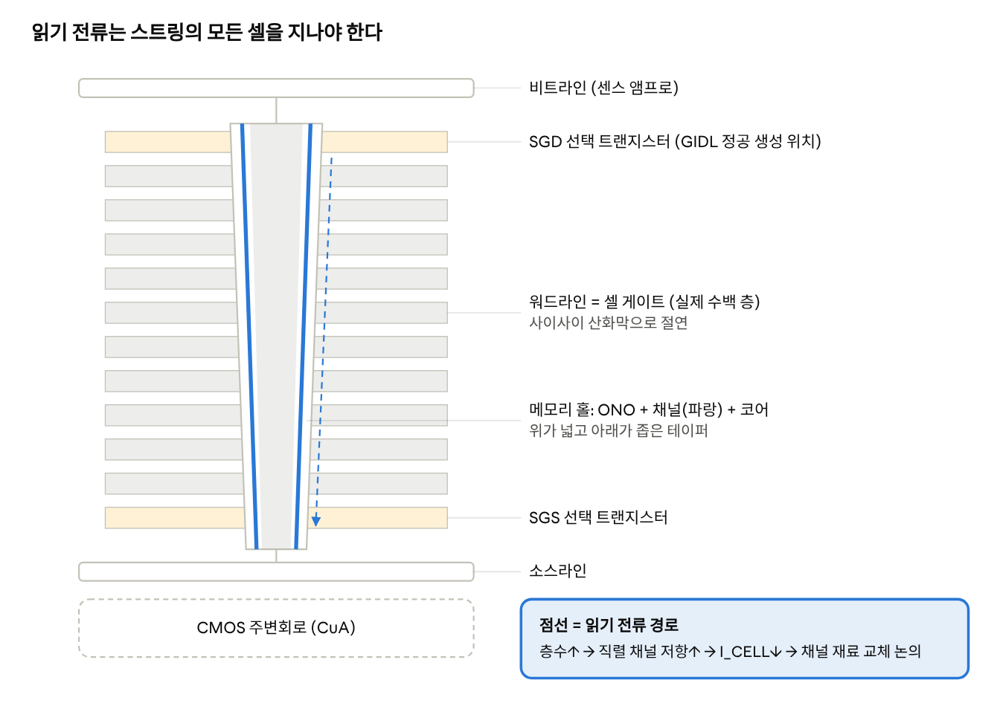
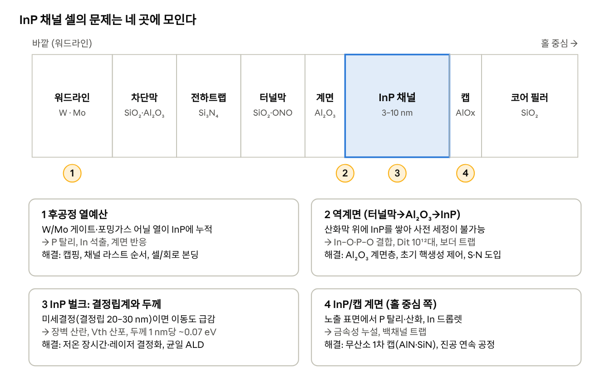
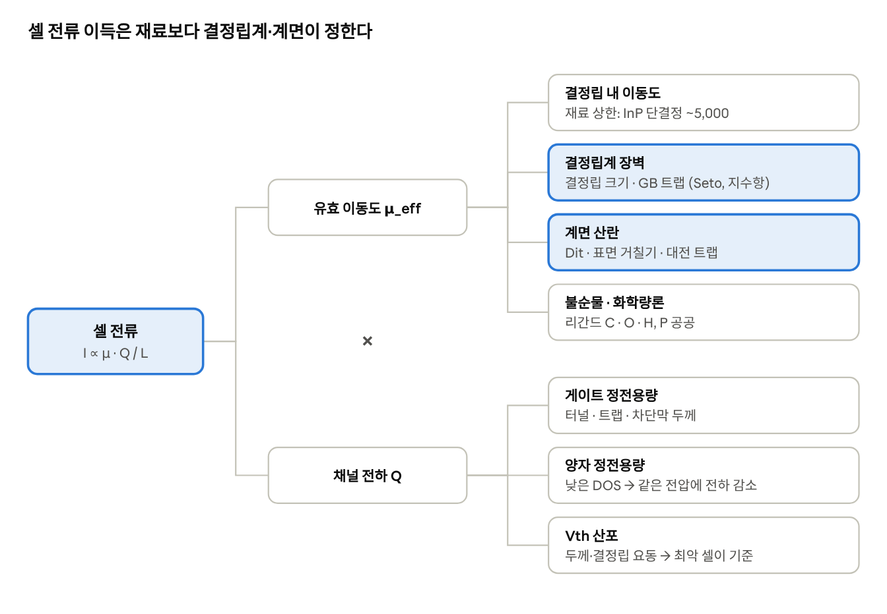
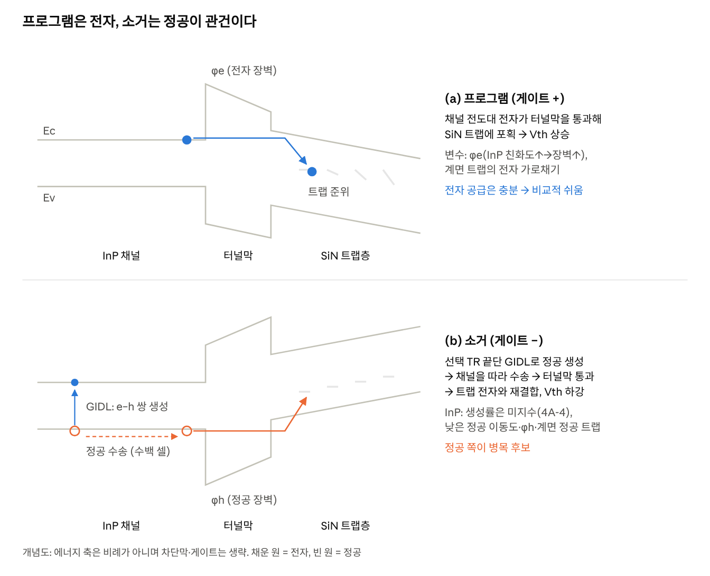
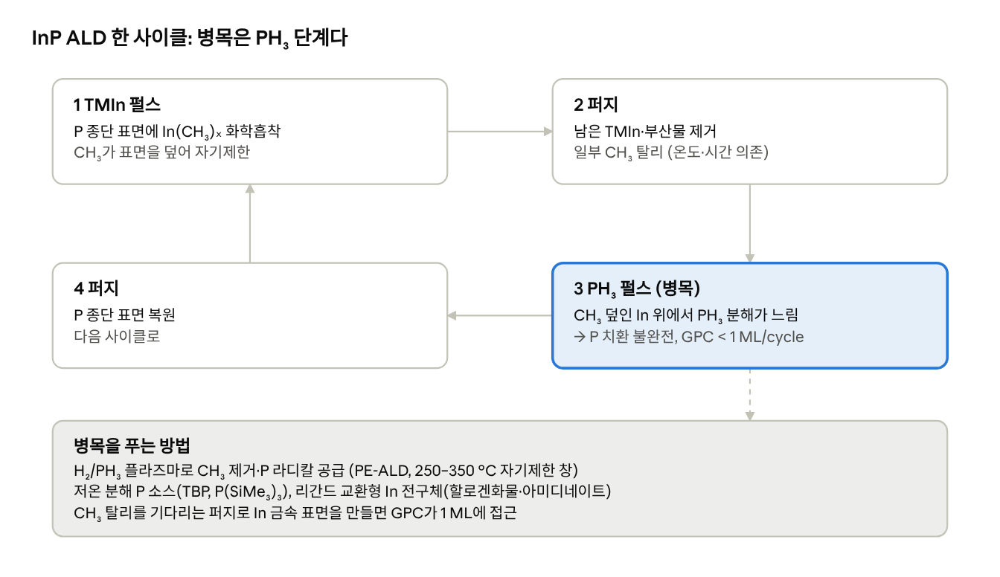
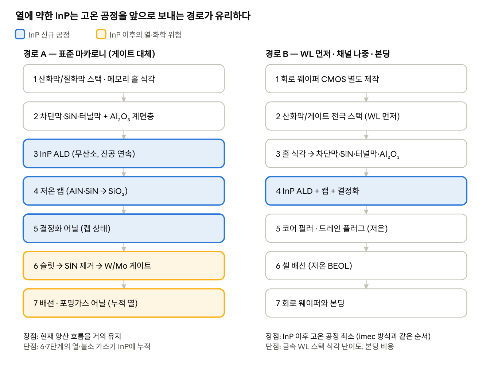
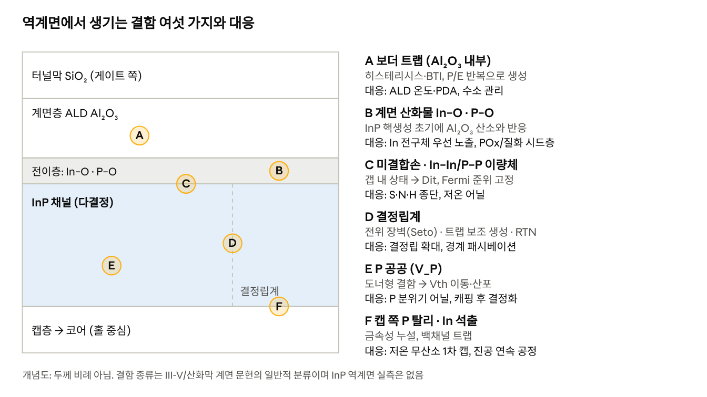

# NAND향 InP 채널 — 보고서 겸 학습 참고서

Nov 10, 2026 · 구본욱

## 0. 한눈 요약

NAND향 InP는 'poly-Si 채널의 낮은 셀 전류를 높은 이동도 III-V로 해결한다'는 아이디어다. III-V 셀 실증은 InGaAs(imec, 2015) 하나뿐이고, InP 채널 NAND를 직접 실증한 공개 문헌은 이번 조사에서 찾지 못했다. 즉 현재는 연구 초기 단계다.

- **왜 거론되나:** 3D NAND poly-Si 이동도는 10 cm²/V·s 미만이고, 층수가 늘수록 셀 전류가 줄어든다. InP는 단결정 기준 이동도가 높고, InGaAs보다 밴드갭(1.34 eV)이 넓어 누설이 작다.
- **어떻게 만들까:** 양산형 마카로니 채널에는 저온(250–350 °C) ALD/PE-ALD로 얼게 쌓고, 캡핑 후 결정화하는 경로가 현실적이다. 에피 선택 성장은 속이 찬 채널에서만 실증됐다.
- **핵심 난제 5가지:**
  1. 산화막 위 저온 InP의 실제 이동도 (미세결정이면 이득이 크게 줄 수 있음)
  2. 소거 — GIDL 정공 생성·수송이 InP에서 충분한지 미검증 (4A장)
  3. 터널막 계면 Dit (InP/Al₂O₃ 대표값 \~2–3×10¹² cm⁻²eV⁻¹)
  4. P 탈리로 인한 열예산 제약
  5. In·P 오염, PH₃ 안전, 비용
- **경쟁자:** 산화물 반도체(IGZO 등) 채널이 저온·컨포멀 증착과 DRAM에서의 팽 경험으로 앞서 있다. 단, 산화물도 소거 문제를 같이 겪는다.
- **결론:** InP를 추진한다면 TCAD로 손익분기 이동도·Dit를 먼저 구하고, 평면 박막→평면 전하트랩 소자→테스트 홀 순서로 검증한다(10장). 전구체 선정은 [내 III-V DB](https://github.com/Gubonwook/memo/tree/main/iii-v-precursors)와 연결한다.

**읽는 법:** 1–4장은 개념, 4A장은 물리 메커니즘(식·그림), 5–7장은 공정(6A장에 구조별 문제–해결 총정리), 8–9장은 리스크, 10장은 실행 계획이다. 모르는 용어는 11장 용어집을 본다.

## 1. 배경 — 3D NAND와 poly-Si 채널의 한계

3D NAND는 셀을 옆으로 줄이는 대신 위로 쌓는다. 층수가 늘수록 직렬로 연결된 셀이 많아져 읽기 전류(셀 전류, I\_CELL)가 줄어드는 것이 채널 재료 교체 논의의 출발점이다.

**구조 한 줄 요약**

- 워드라인(W 등 금속)과 산화막을 번갈아 수백 층 쌓은 스택에 메모리 홀(지름 수십\~100 nm대)을 수직으로 뚫는다.
- 홀 벽에 차단 산화막 → 전하트랩 SiN → 터널 산화막을 입히고, 그 안쪽에 얇은 poly-Si 채널을 관 모양으로 입힌 뒤 가운데를 산화막으로 채운다. 이 관 모양을 '마카로니 채널'이라 부른다.
- 한 홀이 하나의 NAND 스트링이며, 위아래 끝의 선택 트랜지스터를 거쳐 비트라인과 소스라인에 연결된다.



그림 0. 3D NAND 스트링 하나의 수직 단면(층수 축소). 모든 셀이 하나의 채널 관을 공유하므로, 채널 재료를 바꾸면 읽기·프로그램·소거가 모두 바뀐다. 홀이 아래로 갈수록 좁아지는 것도 채널 두께 균일성 문제의 뿌리다.

**poly-Si 채널이 문제인 이유**

1. 낮은 이동도: 3D NAND poly-Si 채널의 이동도는 보통 10 cm²/V·s 미만으로, 층수가 수백 층이 되면 셀 전류와 센싱 마진이 부족해진다 ([Sun et al., arXiv 2112.07992](https://arxiv.org/pdf/2112.07992)).
2. 결정립계: 전도가 결정립 크기 분포에 좌우되고 결정립계·대전 결함에서 산란된다. 그 결과 드라이브 전류가 층수에 비례해 줄어 장기 확장이 어렵다는 것이 imec의 설명이다 ([imec, 2015](https://www.imec-int.com/en/articles/imec-advances-drive-current-in-vertical-3d-nand-memory-devices)).
3. 산포·불안정: 결정립계 전하 트랩이 Vth 분포를 넓히고 시간에 따른 Vth 불안정을 만든다 ([Sun et al.](https://arxiv.org/pdf/2112.07992)).
4. 기하 제약: 홀이 깊어질수록 식각이 어렵고 채널을 더 얇게 만들기도 어렵다. 얇은 poly-Si는 이동도가 더 떨어진다.

**업계의 현실적 대응**은 재료 교체보다 구조 쪽이다. 스택을 여러 덱으로 나눠 쌓거나, 셀 아래에 주변회로를 두거나(CuA/PUC), 웨이퍼 본딩으로 셀과 회로를 따로 만드는 방식이 쓰인다. 채널 재료 교체(산화물 반도체, III-V)는 아직 연구 단계로 보는 것이 맞다.

## 2. InP 기초 — 물성과 후보 재료 비교

InP는 단결정 기준 전자 이동도가 Si의 약 3배이고 밴드갭이 Si보다 넓다. 다만 NAND 채널은 산화막 위에 쌓는 다결정·비정질 박막이므로 아래 단결정 값은 '상한선'으로 읽어야 한다.

| 항목 (300 K) | InP | In0.53Ga0.47As | GaAs | Si (단결정) | poly-Si (3D NAND) | a-IGZO |
| --- | --- | --- | --- | --- | --- | --- |
| 결정 구조 | 섬아연광 | 섬아연광 | 섬아연광 | 다이아몬드 | 다결정 | 비정질 |
| 격자상수 (Å) | 5.87 | 5.87 (InP 정합) | 5.65 | 5.43 | — | — |
| 밴드갭 (eV) | 1.34 (직접) | 0.75 (직접) | 1.42 (직접) | 1.12 (간접) | \~1.1 | \~3.0–3.5 |
| 전자 이동도 (cm²/V·s) | \~5,000 | \~10,000+ | \~8,500 | \~1,400 | <10 | \~10–30 |
| 전자 유효질량 (m₀) | 0.08 | 0.04 | 0.067 | 0.26 (전도) | — | \~0.3 |
| 유전상수 | 12.5 | 13.9 | 12.9 | 11.7 | 11.7 | \~10–16 |
| 열전도도 (W/cm·K) | 0.68 | \~0.05 | 0.55 | 1.5 | 낮음 | 매우 낮음 |
| 융점 (°C) | 1,062 | — | 1,238 | 1,414 | — | — |
| 표면 특징 | P 탈리(약 350 °C\~), 불안정 산화물 | As 탈리, 표면 결함 많음 | 강한 Fermi 고정 | 안정한 SiO₂ | 결정립계 트랩 | 산소 결손·수소 민감 |

수치는 단결정 반도체의 교과서적 대표값이다(예: Ioffe 반도체 물성 DB). 이 세션에서는 원문 페이지를 열지 못했으므로 설계에 쓸 때는 원전에서 다시 확인해야 한다. poly-Si 값은 [Sun et al.](https://arxiv.org/pdf/2112.07992)에서 가져왔다.

**채널 관점에서 꼭 기억할 것**

- **낮은 유효질량의 양면:** 이동도는 높지만 상태밀도(DOS)가 낮다. 얇은 채널에서는 양자 구속으로 서브밴드가 크게 올라가 Vth가 두께 변동에 민감해진다.
- **밴드갭 1.34 eV:** InGaAs(0.75 eV)보다 넓어 밴드 간 터널링(BTBT)·열생성 누설이 작다. 비선택 셀의 off 누설과 선택 트랜지스터 누설에 유리하다.
- **홀 생성 문제:** 기존 NAND는 GIDL이나 p형 기판에서 정공을 공급해 소거한다. InP의 정공 이동도는 전자보다 훨씬 낮고, 정공 생성 효율도 NAND 조건에서 검증된 적이 없어 소거 방식을 다시 검증해야 한다(4·4A장).
- **열적 안정성:** P는 증기압이 높아 고온에서 표면 P가 빠져나가 In 드롭렛이 생긴다. 이후 공정의 열예산이 제한된다(6장).
- **InP vs InGaAs:** InGaAs는 이동도가 더 높지만 누설이 크다. InP는 그 사이 절충안이며, 성분 조절이 없는 2원계라 박막 증착 제어가 상대적으로 쉽다.

## 3. 왜 NAND에 InP/III-V 채널인가 — 후보 비교와 근거

III-V 채널은 셀 전류를 크게 늘릴 수 있다는 실험 근거(InGaAs, 2015)가 있다. 하지만 InP 단독으로 NAND 셀을 실증한 공개 문헌은 이번 조사에서 찾지 못했다. InP는 특허의 청구 항목과 InGaAs 연구의 연장선에서 거론되는 수준이다.

**실제 있는 근거**

- **imec, IEDM 2015 (Capogreco 외):** BiCS형 3층 스택의 45 nm 홀에 게이트 먼저·채널 나중(gate-first, channel-last) 방식으로 MOVPE In₀.₆Ga₀.₄As를 선택 성장했다. poly-Si 대비 on 전류와 gm이 개선됐고 프로그램·소거·내구성 열화는 없었다 ([Semiconductor Today](https://www.semiconductor-today.com/news_items/2015/dec/imec_181215.shtml), [논문 서지](https://www.imec-publications.be/entities/publication/30653271-77cc-4124-995f-6a04a05634b3/full)).
- 같은 연구에서 Ion/Ioff 약 3자리를 얻었고 imec는 이를 NAND 동작에 충분하다고 봤다 ([phys.org](https://phys.org/news/2015-12-imec-advances-current-vertical-3d.html)). 채널은 사내 poly-Si 대비 10배 개선이었다고 한다 ([SemiWiki](https://semiwiki.com/semiconductor-manufacturers/5328-iedm-blogs-part-4-imec-ingaas-channel-for-3d-nand/)).
- 한계: 속이 찬(full) 채널이었고 양산형 마카로니 채널과 금속 게이트 통합은 과제로 남았다. 에피 선택 성장이라 홀 바닥의 Si에서 자라 올라오는 방식이었다.
- **SanDisk 특허 (US20160284723A1 등):** III-V 수직 채널 NAND를 청구하며 InGaAs를 주 실시예로, InP를 대안 목록에 둔다. 채널에 직접 닿는 Al₂O₃ 터널막, 금속-III-V 합금 드레인, 홀 내 나노와이어 성장 등을 제시한다 ([Google Patents](https://patents.google.com/patent/US20160284723A1/en)).

**후보 채널 비교 (정성 평가)**

| 후보 | 장점 | 단점 | 성숙도 |
| --- | --- | --- | --- |
| poly-Si | 양산 검증, 정공 생성으로 소거 쉽음 | 이동도 <10, 결정립계 산포 | 양산 표준 |
| 산화물 (a-IGZO, In₂O₃ 등) | ALD 저온 증착, 결정립계 없음, 초저 누설 | 정공 없어 소거 어려움, 수소·열 안정성 | NAND는 연구, DRAM은 활발 |
| InGaAs | 이동도 최고, NAND 셀 실증(2015) | 작은 밴드갭→누설, 대부분 에피 필요 | 연구 (단발성) |
| InP | InGaAs보다 넓은 밴드갭, 2원계 | 산화막 위 저온 결정 성장 어려움, P 탈리 | 소자 실증 문헌 미발견 |

산화물 채널은 저온·균일 증착과 초저 누설 때문에 3D NAND 대안으로 거론되며 300 °C 열예산으로 소자를 만든 예가 있다 ([Sun et al.](https://arxiv.org/pdf/2112.07992)). 그러나 정공이 없어 소거가 어렵기 때문에 필러 가운데 p형 Si를 넣는 구조까지 제안되고 있다 ([Nanoscale Adv. 2026](https://pubs.rsc.org/en/content/articlepdf/2026/na/d5na00844a)). 업계 주력 관심은 현재 산화물 채널을 DRAM(수직 채널 트랜지스터)에 쓰는 쪽이다 ([Semiconductor Engineering](https://semiengineering.com/oxides-bring-low-leakage-transistors-to-leading-edge-memories/)).

**InP를 두고 전문가가 물을 핵심 질문**

1. 400 °C 안팎에서 산화막 위에 쌓은 InP의 실제 이동도가 poly-Si(≈10)를 의미 있게 넘는가?
2. 소거에 필요한 정공을 어디서 공급하는가?
3. 터널막 계면(Dit)이 수천 번 P/E 사이클을 버티는가?
4. In·P가 팽에 들어오는 오염·안전 비용을 감수할 만큼 이득이 큰가?

## 4. 소자 구조와 동작 — InP가 바꾸는 것

셀 구조는 poly-Si와 같고 채널 관 하나만 InP로 바뀐다. 그러나 읽기는 좋아지고 소거는 어려워지는 비대칭이 생긴다.

**셀 단면 (바깥 → 안)**

1. 워드라인 금속 (W, 최근 Mo 도입 논의)
2. 차단막 (SiO₂ 또는 Al₂O₃ + SiO₂)
3. 전하트랩층 (Si₃N₄)
4. 터널막 (SiO₂ 또는 밴드 엔지니어링 ONO). III-V 채널에서는 채널과 맞닿는 계면층으로 ALD Al₂O₃가 제안된다 ([특허](https://patents.google.com/patent/US20160284723A1/en)).
5. **채널: InP** (마카로니 두께 수 nm\~10 nm대가 목표)
6. 코어 필러 (SiO₂)



그림 1. 셀 한 개를 반지름 방향으로 자른 단면이다. 기존 poly-Si 셀과 달리 InP는 양쪽 계면(터널막 쪽, 캡 쪽)과 벌크, 그리고 후공정의 열이 모두 문제 지점이 된다.

**동작별로 바뀌는 점**

| 동작 | poly-Si에서의 방식 | InP 채널에서 생기는 변화 |
| --- | --- | --- |
| 읽기 | 비선택 WL에 Vpass, 선택 셀 Vth 판별 | 이동도↑→셀 전류↑, 센싱 속도↑. 다만 낮은 DOS로 게이트 제어력이 달라지고 Vth가 두께에 민감 |
| 프로그램 | 채널 전자를 FN 터널링으로 트랩에 주입 (ISPP) | 전자 공급은 충분. 터널막/채널 밴드 오프셋과 계면 트랩이 주입 효율을 좌우 |
| 소거 | GIDL로 정공 생성 → 채널 전위↑ → 정공을 트랩에 주입 | BTBT 정공 생성률은 밴드갭과 유효질량이 함께 정해 poly-Si 대비 우열이 불확실하고(4A장), 정공 수송·계면 정공 트랩까지 검증해야 해 **소거가 핵심 병목** |
| 억제(inhibit) | 채널 부스팅으로 비선택 스트링 보호 | 누설(트랩 생성)이 크면 부스팅 전위가 새어 프로그램 디스터브 증가 |

**소거 문제 자세히**

- CuA(셀 아래 회로) 구조에서는 채널이 기판과 끊겨 있어 기판 정공을 쓸 수 없고, 선택 트랜지스터 근처의 GIDL로 정공을 만든다 ([MDPI Electronics 2025](https://www.mdpi.com/2079-9292/14/7/1461)).
- GIDL은 밴드 간 터널링·트랩 보조 생성으로 전자-정공 쌍을 만드는 현상이다 ([특허 US11081196](https://image-ppubs.uspto.gov/dirsearch-public/print/downloadPdf/11081196)). poly-Si에서도 정공 생성이 느려 소거 속도가 문제로 지적된다 ([JSTS 2026](https://jsts.org/jsts/XmlViewer/f451685)).
- 주의(수정): 밴드갭 1.34 eV만 보면 BTBT가 약할 것 같지만, InP는 직접 천이이고 유효질량이 작아 터널링 지수가 작아진다. 또 poly-Si의 GIDL에는 결정립계 트랩 보조 생성이 크게 기여한다. 따라서 InP의 GIDL 효율은 계산·실측으로 확인해야 할 미지수다(4A장).
- 대응 후보 (산화물 채널에서 제안된 것들을 참고): (a) 필러 중심에 p+ Si 정공 공급로, (b) 홀 바닥에 p+ Si 연결부, (c) 선택 트랜지스터 끝단만 Si 또는 작은 밴드갭 재료로 바꿔 GIDL 강화, (d) 양측 GIDL. InP에 적용한 문헌은 못 찾았다.

**기타 설계 변수**

- **접합:** 비트라인·소스 접촉은 n+ InP 도핑이나 금속-InP 합금(예: Ni-InP)으로 만드는 안이 특허에 있다.
- **선택 트랜지스터 누설:** 특허는 III-V 채널의 장점으로 낮은 SS와 낮은 선택 트랜지스터 누설을 꼽는다.
- **셀 간 간섭:** 채널 유전상수(12.5)가 Si(11.7)와 비슷해 정전 결합은 큰 차이가 없다.

## 4A. 물리 메커니즘 — 셀 안에서 실제로 무슨 일이 일어나나

이 장은 증착법과 상관없이 InP 채널 NAND를 판단할 때 필요한 원리를 모았다. 식과 계산은 교과서적 모델이고, 숫자는 추세를 보기 위한 대략값이다. 설계에는 TCAD·실측으로 다시 구해야 한다.

### (1) 다결정 채널의 전도 — 결정립계 장벽 모델

다결정 반도체에서는 결정립계의 트랩이 전자를 잡아 음전하를 띤다. 그 주변이 공핍되며 전자가 넘어야 하는 에너지 장벽(V\_B)이 생긴다(Seto 모델). 유효 이동도는 결정립 안 이동도에 장벽 통과 확률이 곱해진 꼴이다.

```math
\mu_{\mathrm{eff}} \approx \mu_{0}\,\exp\!\left(-\frac{qV_B}{k_B T}\right), \qquad V_B \approx \frac{q N_t^{2}}{8\,\varepsilon\, N_D}\;(\text{부분 공핍})
```

- N\_t는 결정립계 트랩 면밀도, N\_D는 캐리어 농도다. **결정립이 크고 결정립계 트랩이 적을수록** 장벽이 낮아진다.
- 시사점: InP 단결정 이동도(\~5,000)가 높아도 지수항 때문에 다결정 InP는 수십\~수백으로 떨어질 수 있다. 즉 **이동도 이득의 크기는 재료보다 결정립계 품질이 결정한다.**
- 게이트 전압이 채널에 전자를 채우면 결정립계 트랩이 채워져 장벽이 낮아진다. 그래서 다결정 채널은 문턱 근처에서 SS가 나빠지고 Vth가 온도에 민감하다.
- 시리즈 저항으로 보면, 한 번 읽을 때 스트링 전체(수백 셀)가 켜져 있어야 한다. 셀 전류는 대략 층수에 반비례한다. 채널 저항이 채널 교체의 직접 동기다.

### (2) 얇은 채널의 양자 구속 — InP가 두께에 더 민감한 이유

두께 t인 채널에 갇힌 전자의 바닥 에너지는 무한 우물 근사로 다음만큼 올라간다.

```math
\Delta E_{1} = \frac{\hbar^{2}\pi^{2}}{2\,m^{*} t^{2}}, \qquad \frac{d\Delta E_1}{dt} = -\frac{2\,\Delta E_1}{t}
```

| t (nm) | InP (m\* = 0.08) ΔE₁ | Si (m\* ≈ 0.26 가정) ΔE₁ |
| --- | --- | --- |
| 4 | ≈ 0.29 eV | ≈ 0.09 eV |
| 5 | ≈ 0.19 eV | ≈ 0.06 eV |
| 8 | ≈ 0.07 eV | ≈ 0.02 eV |

- t = 5 nm에서 InP는 두께 1 nm 변화에 약 0.075 eV가 변한다. 이는 Vth 변동으로 직결된다. 홀 위아래 두께 차이나 결정립 경계의 국부 두께 요동이 Si보다 약 3배 크게 보인다.
- 수치는 무한 우물 근사이므로 실제(유한 장벽, 비포물선성)는 이보다 작다. 방향성만 읽는다.
- 낮은 상태밀도(DOS)는 양자 정전용량을 작게 만든다. 게이트→채널 전하 유도가 줄어 동일 Vpass에서 예상보다 전류 이득이 작을 수 있다(‘DOS 병목’).



그림 6. (1)·(2)를 합친 셀 전류의 드라이버 트리. InP가 올리는 것은 맨 위 항목(결정립 내 이동도) 하나뿐이다. 강조한 두 항목(결정립계, 계면)은 공정이 정하며 이득 대부분을 깎을 수 있다. 양자 정전용량과 Vth 산포는 오히려 InP에 불리하게 작용한다.

### (3) 프로그램 — Fowler–Nordheim 터널링

프로그램은 채널 전자가 터널막의 삼각 장벽을 통과해 SiN 트랩에 들어가는 것이다.

```math
J_{\mathrm{FN}} = A\,E_{ox}^{2}\,\exp\!\left(-\frac{B\,\phi_B^{3/2}}{E_{ox}}\right), \qquad B \propto \sqrt{m_{ox}^{*}}
```

- φ\_B는 채널 전도대와 터널막 전도대의 차(전자 장벽)다. 전자 친화도가 큰 InP는 SiO₂에 대한 장벽이 Si보다 약간 높아진다(친화도 값은 원전 확인 필요). φ\_B^{3/2}가 지수에 들어가므로 작은 차이도 ISPP 시작 전압을 옮긴다.
- 채널 쪽 계면 트랩이 많으면 주입 전자 일부가 계면에 갇혀 Vth를 옮기고, 이후 풀려나며 초기 보존 손실을 만든다.
- Al₂O₃ 계면층을 넣으면 터널 장벽이 SiO₂/Al₂O₃ 이중층이 된다. Al₂O₃는 장벽이 낮고 유전상수가 높아 두께·순서에 따라 프로그램 속도와 보존이 맞바뀜다. BE-TOX(밴드 엔지니어링 터널막)와 같은 원리다.

### (4) 소거 — GIDL과 밴드 간 터널링(BTBT)

선택 트랜지스터 끝단에 큰 전계를 걸면 가전자대 전자가 전도대로 터널링하며 전자-정공 쌍이 생긴다. Kane 모델의 생성률은 다음과 같다.

```math
G_{\mathrm{BTBT}} = A\,\frac{F^{2}}{\sqrt{E_g}}\,\exp\!\left(-\frac{B_0\sqrt{m_r^{*}}\,E_g^{3/2}}{F}\right)
```

- 지수에는 E\_g^{3/2}와 √m\_r\*이 함께 들어간다. InP는 E\_g가 Si보다 크지만(1.34 vs 1.12 eV) 환산 유효질량이 훨씬 작고 직접 천이다.
- 대략 비교(m\_r\* InP ≈ 0.07, Si ≈ 0.2 가정): E\_g^{3/2}√m\_r\* 값은 InP ≈ 0.41, Si ≈ 0.53이다. **InP의 지수 인자가 오히려 작아 BTBT가 더 잘 일어날 수도 있다.** 간접 천이인 Si는 포논 보조가 필요해 실제로 더 느리다.
- 반면 poly-Si의 GIDL은 결정립계 트랩을 거치는 트랩 보조 생성(TAT)이 크게 기여한다. InP가 결정성이 좋아질수록 이 기여는 줄어든다.
- 결론: **소거의 병목은 ‘정공을 만드느냐’보다 ‘만든 정공을 수백 셀 끝까지 보내고 터널막을 통과시키느냐’일 가능성이 크다.** InP 정공 이동도(단결정 대표값 \~150–200 cm²/V·s, 원전 확인 필요)는 전자보다 훨씬 낮고, 계면 가전자대 쪽 트랩이 정공을 가둠 수 있다. 또 InP/SiO₂ 가전자대 장벽이 정공 주입 효율을 정한다.
- 부수 효과: BTBT가 쉽다면 비선택 스트링의 부스팅 전위가 BTBT로 새어 프로그램 디스터브가 커질 수 있다. 특허가 주장하는 ‘낮은 선택 트랜지스터 누설’과 충돌할 수 있어 실측이 필요하다.



그림 2. 밴드 개념도. 프로그램은 채널에 넘치는 전자를 쓰므로 InP에서도 비교적 쉽다. 소거는 정공을 만들고(GIDL) 멀리 보내고(수송) 터널막을 넘겨야(φh) 하는 3단계라 어느 한 곳만 막혀도 실패한다.

### (5) 보존 — 전하가 새어 나가는 경로

1. **직접/트랩 보조 터널링(TAT):** 터널막 내 결함을 디딘돌로 삼아 전하가 채널로 돌아간다. 계면 트랩이 많을수록 디딘돌이 늘어난다.
2. **열방출(Poole–Frenkel):** SiN 안의 얕은 트랩에서 열에너지로 빠져나온다. 채널 재료와 대체로 무관하다.
3. **측방 확산:** 인접 셀 사이 SiN을 따라 전하가 퍼진다. 셀 간격·SiN 단절과 관련되며 채널과는 간접적이다.
4. **채널 측 요인(InP 고유):** 결정립계·계면에 갇혔던 전하가 풀려나며 생기는 Vth 이동. 실제 트랩 전하 손실이 없어도 ‘보존 불량’처럼 보인다. 온도 가속 시험에서 활성화 에너지로 1–3을 구분한다.

### (6) 내구 열화 — 스트레스가 만드는 결함

- P/E 때 터널막을 지나는 고에너지 전자·정공이 결합을 끊어 산화막 트랩과 계면 트랩을 만든다. 메모리 창 닫힘과 SS 악화로 나타난다.
- Si/SiO₂에서는 Si–H 결합 해리가 대표 기구다. InP에서는 In–O·P–O 결합, 수소 이동, Al₂O₃ 보더 트랩 생성이 후보 기구다. InGaAs/Al₂O₃에서는 양 바이어스 스트레스가 회복성 도너 트랩과 영구 억셉터 트랩을 만든다는 모델이 있다(8장 참고).
- 주의: 수소는 Si에서는 결함을 패시베이션하지만, 산화물·III-V에서는 도너나 이동성 대전 종으로 작용할 수 있다. 포밍가스 어닐의 효과를 InP에서 따로 확인해야 한다.

### (7) 열적 불안정 — P 탈리와 산화

- InP는 가열하면 표면에서 P가 P₂/P₄ 기체로 빠져나가고(일치 증발이 아닌 비일치 분해) 금속 In이 남는다. In은 융점이 157 °C라 드롭렛으로 뭉치고 연결되면 금속성 누설 경로가 된다.
- MOVPE가 성장 중 PH₃ 과압을 유지하는 이유다. 닫힌 캡핑층은 같은 역할을 고체로 한다.
- 산소가 있으면 In₂O₃·InPO₄·In(PO₃)₃ 등이 생기고 P 산화물은 휘발하기 쉽다. 캐핑층 증착 자체(산소원 사용)가 채널 윗면을 산화시킬 수 있으므로, 처음 몇 사이클은 산화제 없는 막(예: 열 ALD AlN, SiN) 또는 산화제 노출 최소 조건이 필요하다.

### (8) 결정화 메커니즘 — 비정질에서 다결정으로

고상 결정화(SPC)는 핵생성과 성장의 경쟁이다. 결정화된 분율 X(t)는 JMAK 식으로 기술한다.

```math
X(t) = 1 - \exp\!\left[-(k t)^{n}\right], \qquad k = k_0\exp\!\left(-\frac{E_a}{k_B T}\right), \qquad d_{\mathrm{grain}} \propto \left(\frac{v_g}{I}\right)^{1/3}
```

- 최종 결정립 크기는 성장 속도(v\_g)와 핵생성률(I)의 비가 정한다. 핵생성의 활성화 에너지가 더 커서, **낮은 온도에서 오래 어닐하면 핵이 덜 생겨 결정립이 커진다.** poly-Si 채널이 저온 장시간 어닐을 쓰는 이유다.
- 얇은 막(수 nm)에서는 결정립이 두께보다 커지기 어렵고 계면 에너지가 핵생성 장소를 정한다. 터널막·캡핑층 계면에서 동시에 핵이 생기면 미세결정이 된다.
- InP에서는 저온 어닐이 유리한 대신 조성 편차(P 과부족)가 결정화를 방해한다. 화학량론에서 벗어난 성분은 결정립계에 편석되거나 In 석출로 나타난다.
- 선택지: (a) 레이저·플래시 어닐로 표면만 짧게 가열, (b) 홀 바닥 Si나 시드층에서 시작하는 측방·수직 결정화(마카로니를 따라 위로), (c) 금속 유도 결정화는 오염 위험이 커서 비추천, (d) 자라는 중 결정을 얻는 PE-ALD 고온부(창 안에서) 최적화.

### (9) Fermi 준위 고정 — 왜 III-V 표면은 게이트가 안 먹히나

- 표면 에너지 간극에 상태(결함·미결합손·역치 결함)가 많으면 게이트가 유도한 전하가 채널 대신 이 상태를 채운다. Fermi 준위가 특정 에너지에 묶인다.
- 기원 후보: In–In / P–P 이량체, P 공공(V\_P), In 댄글링 본드, 산화 중간상. 일부는 전도대 근처에, 일부는 밴드갭 중앙에 위치한다.
- InP는 전통적으로 전도대 근처에 표면 고정이 있고 GaAs보다 n형 축적이 쉽다고 알려져 있다. 이는 n채널 NAND에는 유리한 방향이다. 다만 소거에 필요한 정공 축적(가전자대 쪽)에는 불리할 수 있다.
- 해제 수단은 7장(자기세정 ALD, 황·질소 처리, POx 계면층)에 있다.

## 5. 만드는 법 1 — 증착

NAND 홀 안에 InP를 넣는 현실적 경로는 두 가지다. 홀 바닥 Si에서 에피를 키우는 선택 성장(imec 방식)과, 터널막 위에 ALD로 얼게 입힌 뒤 결정화하는 방식(마카로니 호환)이다. 양산형 마카로니 채널에는 후자가 맞다.

**증착법 비교**

| 방법 | 온도 | 결정성 | 마카로니 적합성 | 문헌 예 |
| --- | --- | --- | --- | --- |
| MOVPE 선택 에피 (홀 채움) | 450–650 °C대 (일반 MOVPE) | 단결정\~쌍정 포함 | 낮음 (속 찬 채널) | imec InGaAs 2015 |
| ALE (TMIn/PH₃ 교대 공급) | 350 °C에서 자기제한, \~0.5 ML/cycle | 에피 (InP 기판 위) | 중간 | [JJAP 1988](https://scilit.com/publications/b03b191489c06d34e0108be9788e272a) |
| MLE (TEIn/TBP, UHV) | 320–340 °C, \~0.7 ML/cycle | 에피, SiN 위에는 미증착(선택성) | 중간 | [Otsuka 외](https://www.taylorfrancis.com/chapters/edit/10.1201/9781003063100-86/self-limiting-submonolayer-growth-inp-alternative-triethylindium-tertiarybutylphosphine-supply-ultra-high-vacuum-nobuyuki-otsuka-jun-ichi-nishizawab-hideyuki-kikuchib-yutaka-oyamac) |
| PE-ALD (TMIn/PH₃ + H₂ 플라즈마) | 250–350 °C 자기제한, 380 °C부터 비이상 성장 | 미세결정 (결정립 20–30 nm) | 높음 (후보 1순위) | [Uvarov 2025](https://physmath.spbstu.ru/en/article/2025.82.49), [Gudovskikh 2023](https://journals.ioffe.ru/articles/57157) |
| 저온 템플릿 액상 성장(LT-TLP) | 220 °C까지 | 비정질 기판 위 단결정 패턴 | 낮음 (평면 패턴용) | [PNAS, UC Berkeley](https://escholarship.org/content/qt5kj3x6pt/qt5kj3x6pt.pdf?t=s9f5qw) |
| 스퍼터/PLD + 어닐 | 상온 증착 + 100–600 °C 어닐 | 비정질 TFT 수준 | 낮음 (비컨포멀) | [BOE 특허](https://image-ppubs.uspto.gov/dirsearch-public/print/downloadPdf/9461070) |

**ALD/ALE 화학에서 알아야 할 것**

- TMIn을 P 안정화 표면에 공급하면 CH₃로 덮인 In 표면에서 포화된다. 그 위에서 PH₃ 분해가 느려 성장률이 1 ML/cycle 미만으로 제한된다([NTT, SPA 연구](https://data.zhenzhi.com/details/1/1004327906); [KPS 1999](https://inis.iaea.org/records/1d699-bdm91)).
- 즉 **병목은 P 쪽**이다. 플라즈마(H₂, PH₃)로 리간드를 떼거나, 더 반응성 높은 P 소스(TBP, P(SiMe₃)₃ 등)를 쓰는 것이 저온화의 핵심이다.
- PE-ALD는 250–350 °C에서 GPC가 일정해 자기제한 거동을 보였고, 400 cycle로 26–44 nm를 얻었다. 온도가 오를수록 라만 LO 피크가 강해져 결정성이 좋아졌다([Uvarov 2025](<https://physmath.spbstu.ru/userfiles/files/articles/2025/3.1/49_247-251_18(3_1)2025.pdf>)).
- 산화제가 없는 공정이어야 한다. 반응기 잔류 O₂/H₂O는 In₂O₃·InPO₄ 계면을 만들어 Dit를 올린다. 전구체도 산소 미함유형을 우선한다.



그림 4. TMIn/PH₃ ALD의 표면 반응. In 쪽은 쉽게 포화되지만 표면에 남은 CH₃가 PH₃ 분해를 막는다. 따라서 저온화의 열쇠는 P 단계의 반응성이며, 내 DB의 P 반응물 표(31\_P\_reactants)에서 분해 온도가 낮은 소스를 고르는 것이 출발점이다.

**전구체·반응물 선택 (내 DB 연결)**

이전에 만든 [III-V 전구체 DB](https://github.com/Gubonwook/memo/tree/main/iii-v-precursors)의 테이블을 그대로 활용한다.

- **In 전구체 (10\_In\_O-free.csv):** TMIn(표준, 높은 증기압), TEIn(낮은 분해 온도), DADI·아미디네이트류(저온 ALD 후보).
- **P 반응물 (31\_P\_reactants.csv):** PH₃(독성 매우 큼, 저온 분해 느림), TBP(저온 분해, 독성 분류가 출처마다 다름), TDMAP, P(SiMe₃)₃(할로겐화물/알콜시드 전구체와 탈실릴 반응 가능).
- **매칭 원칙 (50\_supercycle\_matching.csv 방식):** In 전구체의 ALD 창과 P 반응물의 분해 시작 온도가 겹치는 구간을 찾는다. 그 구간이 NAND 열예산(≤ 약 400 °C대) 안에 있어야 한다.

**증착 후 결정화 전략**

1. 저온(200–300 °C) ALD로 비정질/미세결정 InP를 컨포멀하게 증착한다.
2. SiO₂·Al₂O₃ 캡핑층으로 덮어 P 탈리를 막는다.
3. RTA 또는 레이저/마이크로파 어닐로 결정화한다. 온도·시간은 InP 기준 데이터가 거의 없어 직접 실험으로 잡아야 한다.
4. 필요하면 PH₃/TBP 분위기 어닐로 P 결손을 보상한다.

## 6. 만드는 법 2 — 고종횡비 홀에 집적하기

가장 어려운 조건은 종횡비 50:1 이상인 홀의 위아래를 같은 두께·같은 결정성으로 만드는 것이다. 이는 열예산 안에서 해야 한다.

**기하 조건**

- 스택 두께 약 5 µm에 홀 종횡비 약 50:1 수준이며 현재는 60:1 이상으로 알려져 있다 ([Entegris 백서](https://www.entegris.com/content/dam/web/resources/white-papers/whitepaper-improving-3d-nand-performance-8443.pdf)).
- SK hynix는 한 덱의 한계를 약 120층으로 보고 321층에서 3덱을 쓴다. 홀 종횡비 \~1:100에서 곧고 균일한 식각이 어렵기 때문이다 ([SemiAnalysis IEDM 2025](https://newsletter.semianalysis.com/i/184077729/3d-nand-hynix-321-layer)).
- 홀은 위가 넓고 아래가 좁은 테이퍼를 가진다. 아래쪽은 마카로니가 나노와이어처럼 변해 위아래 셀의 Vth 차이가 생긴다 ([Patsnap 요약](https://www.patsnap.com/resources/blog/articles/ald-uniformity-in-3d-nand-word-line-fill-at-100-layers/)).

**집적 순서 (마카로니 InP의 가상 흐름)**

1. CuA 회로 위에 산화막/질화막 스택 증착 → 메모리 홀 식각
2. 차단막 → SiN 트랩 → 터널막 ALD (기존과 동일)
3. **계면층:** ALD Al₂O₃ 수 Å–수 nm (III-V용 터널 계면, 7장)
4. **InP 채널 ALD:** 수 nm–10 nm대, 산소 없는 진공 연속으로 3→4 단계 진행
5. **캡핑:** 저온 ALD SiO₂/Al₂O₃로 P 탈리 방지
6. **결정화 어닐**
7. 코어 필러 채우기 → 상단 리세스 → 드레인 플러그 (n+ InP 또는 금속-InP 합금)
8. 홀 바닥 소스 연결 (기존은 홀 바닥 터널막을 뚫고 Si에 접촉)
9. 슬릿 식각 → SiN 제거 → W/Mo 워드라인 채움 (대체 게이트, 자체 열예산 있음)
10. 배선, 포밍가스 어닐, 패키징

이 중 4–6이 InP 신규 공정이고, 9–10의 후공정 열이 InP에 가해진다는 점이 핵심이다.



그림 5. 두 가지 집적 경로. 경로 A는 지금 양산 흐름에 InP를 끼워 넣는 방식이라, InP가 대체 게이트·배선 공정의 열과 화학을 모두 겪는다. 경로 B는 고온 공정을 InP 앞이나 다른 웨이퍼로 보낸다. 첫 실험은 A의 6·7단계 열을 모사한 어닐로 InP가 얼마나 버티는지 보는 것이 가장 싸고 빠르다.

**관리해야 할 변수**

| 변수 | 왜 중요한가 | 확인 방법 |
| --- | --- | --- |
| 컨포멀리티 (위/아래 두께비) | 두께 차이 = Vth 차이. InP는 낮은 DOS로 더 민감 | 테스트 구조(AR 트렌치) 단면 TEM |
| 플라즈마 접근성 | PE-ALD는 라디칼이 홀 벽에서 재결합해 바닥까지 못 갈 수 있음 | 열 ALD 대비 바닥 두께·조성 비교 |
| In/P 조성비 | P 결손은 도너형 결함, In 과잉은 금속 성분 | XPS, RBS, 깊이별 EDS |
| 결정립 크기·방향 | 이동도와 산포 직결. PE-ALD 예시 20–30 nm | XRD, TEM, 라만 LO/TO |
| 열예산 | P 탈리, In 확산, 계면 반응 | 어닐 전후 XPS·전기 특성 |
| 도핑 | 채널은 저도핑, 접합은 n+ | SIMS, 홀/시트저항 |

**열예산 순서**

poly-Si도 결정립을 키우려면 어닐 온도·시간을 늘려야 하는데 열예산이 이를 막는다 ([특허 US12347679](https://image-ppubs.uspto.gov/dirsearch-public/print/downloadPdf/12347679)). InP는 추가로 P 탈리가 있어 캡핑 없이는 약 350–400 °C대도 위험하다고 보는 것이 안전하다(캡핑 조건별 실측 필요). 따라서 게이트·배선을 먼저 만들고 채널을 나중에 넣는 순서(채널 라스트)나 셀/회로 웨이퍼를 따로 만들어 붙이는 본딩 구조가 유리하다. imec도 게이트 먼저·채널 나중 방식을 썼다.

## 6A. 구조별 문제–메커니즘–해결 총정리

InP 채널 NAND의 문제는 셀 하나 안에서 끝나지 않는다. 스트링 양 끝(선택 트랜지스터, 플러그, 홀 바닥)과 어레이 아래 회로까지 포함해 위치별로 정리했다. 해결 방안 중 InP에서 실증된 것은 거의 없으며, 대부분 III-V MOSFET·산화물 채널 NAND에서 온 아이디어다.

| 구조 위치 | 문제 | 메커니즘 | 해결 방안 | 확인 실험 |
| --- | --- | --- | --- | --- |
| 메모리 홀 기하 (테이퍼, AR 50–100:1) | 위·아래 셀 Vth 차이 | 홀 지름·채널 두께 변화 + InP의 큰 양자 구속 민감도 | 열 ALD 우선(플라즈마 재결합 회피), 두께 목표를 두껍게(≥6–8 nm), WL별 바이어스 보정 | AR 테스트 홀 위/중/바닥 TEM·EDS |
| 터널막 / Al₂O₃ / InP (게이트 쪽) | 높은 Dit, 히스테리시스, 초기 보존 손실 | 산화막 위 핵생성에서 In–O·P–O 형성, 미결합손 | Al₂O₃ IL, In 전구체 선노출, 질화·POx 시드층, 저온 후어닐 | 역구조 MOSCAP 다주파수 C-V, XPS 깊이 분석 |
| InP 벌크 | 이동도 이득 소멸, Vth 산포·RTN | 결정립계 장벽(Seto), 미세결정, 화학량론 편차 | 캐핑 후 저온 장시간/레이저 결정화, 시드 기반 수직 결정화, PE-ALD 창 상단 사용 | 홀 측정, TEM 결정립 통계, 라만 LO/TO |
| InP 표면 / 캡 (홀 중심 쪽) | 누설, 백채널 트랩 | P 탈리, 캡 증착 중 산화, In 석출 | 진공 연속 저온 무산소 1차 캡(AlN·SiN), 이후 SiO₂ | 캡 조건별 어닐 후 시트저항·XPS |
| 드레인 플러그 / 비트라인 접촉 | 높은 접촉 저항 | III-V 오믹 접촉 난이도, 도핑 활성화 열예산 | n+ InP 재성장, Ni–InP 등 금속-III-V 합금(특허 아이디어) | TLM 접촉 저항 |
| 홀 바닥 소스 연결 | 소스 저항, 불균일 | 바닥 산화막 펀치 후 InP–Si(또는 소스라인) 이종 접합 | 측면 소스 접촉 구조, 바닥 n+ Si 플러그 위 InP | 스트링 전류의 온도 의존성 |
| 선택 트랜지스터 (SGD/SGS) | 소거 정공 부족 또는 반대로 누설 과다 | GIDL = BTBT + TAT. InP는 두 기여가 모두 미지수 | 선택 TR 구간만 Si 채널 유지(하이브리드), p+ 정공 공급로, 양측 GIDL | 소거 시간–전압 맵, GIDL I–V 온도 의존성 |
| 채널 전체 (정공 수송) | 아래쪽 셀 소거 지연 | 낮은 정공 이동도 + 계면 정공 트랩 | 코어 필러에 정공 경로(p+ Si) 추가, 소거 펄스 길이 조절 | WL 위치별 소거 Vth |
| 워드라인 대체 공정 | InP 열화 | 고온 W/Mo CVD, 불소 부산물, 습식 식각액 침투 | 채널 라스트(경로 B), 저온 WL 금속, 캡으로 보호 | 모사 열·화학 노출 후 InP 특성 |
| CuA 회로 / 웨이퍼 전체 | P·In 확산, 교차오염 | P는 Si의 도펀트, In은 관리 금속 | 셀/회로 본딩으로 물리적 분리, 배면 세정, 전용 장비 | SIMS, TXRF, CMOS TR 특성 변화 |
| 인접 셀 간 | 디스터브, 간섭 | 부스팅 전위 누설, SiN 측방 전하 확산 | 누설 억제(결정성↑), SiN 단절 구조 병행 | 프로그램·읽기 디스터브 시험 |

**우선순위 판단:** 게이트 쪽 계면, InP 벌크 결정성, 선택 트랜지스터 소거 세 가지가 되지 않으면 나머지는 논의할 의미가 없다. 나머지는 양산 단계 문제다.

## 7. 계면과 게이트 스택

III-V 소자의 성패는 채널보다 계면에서 갈린다. InP는 InGaAs보다 Al₂O₃ 계면 트랩이 적은 편이지만, 대표값 Dit 약 2–3×10¹² cm⁻²eV⁻¹은 Si/SiO₂(≈10¹⁰)보다 두 자리 높다.

**문제의 뿌리**

- III-V 자연산화물(InP의 경우 In₂O₃, InPO₄, PₓOᵧ 등)은 SiO₂처럼 깨끗한 계면을 만들지 못하고 Fermi 준위 고정과 전류 드리프트를 일으킨다 ([Li et al., Front. Phys. 2020](https://www.frontiersin.org/journals/physics/articles/10.3389/fphy.2020.00051/full)).
- 계면 트랩(Dit)은 SS·이동도를 떨어뜨리고, 산화막 안쪽의 보더 트랩은 Vth 히스테리시스와 BTI 열화를 만든다.
- NAND에서는 이 계면이 터널막이다. 매 P/E마다 고전계 터널링 전류가 지나가므로 로직 MOSFET보다 훨씬 가혹한 조건이다.

**실험 문헌의 수치**

| 스택 | 패시베이션/처리 | 결과 | 출처 |
| --- | --- | --- | --- |
| ALD Al₂O₃ (300 °C) / n-InP | 자기세정 ALD, 500 °C PDA | Dit ≈ 2–3×10¹², 히스테리시스 100–300 mV, 최대 유효 이동도 ≈ 650 cm²/V·s, Fermi 고정 해제 | [Purdue 특허 US10541315](https://image-ppubs.uspto.gov/dirsearch-public/print/downloadPdf/10541315) |
| ALD Al₂O₃ / InP(100) | (NH₄)₂S 10%, 5–10분 | 자연산화물 성장 억제, Dit·보더 트랩 최소. 22%는 표면 거칠기 악화 | [Lee et al., Materials 2019](https://pmc.ncbi.nlm.nih.gov/articles/PMC6926807) |
| Al₂O₃ / InP vs Al₂O₃ / InGaAs | HCl → NH₄OH → (NH₄)₂S 20%, PDA 400 °C 30 s | InP 쪽 Dit·보더 트랩이 더 낮음. PBTI로 보더 트랩 생성 | [Li et al. 2020](https://www.frontiersin.org/journals/physics/articles/10.3389/fphy.2020.00051/full) |

**패시베이션 도구상자**

1. **자기세정(self-cleaning) ALD:** TMA 펄스가 자연산화물을 환원·제거한다. In-situ로 가장 쉽다.
2. **황 패시베이션:** (NH₄)₂S 습식 처리는 연구에서 표준이다. 단, 고종횡비 홀 안에서는 습식 처리가 어렵고, 마카로니에서는 채널이 터널막 **위에** 쌓이므로 계면이 아래쪽에 묻힌다. 기상 H₂S 처리나 ALD 중 황 포함 단계가 대안이다.
3. **질소 처리:** N₂/NH₃ 플라즈마로 계면 질화.
4. **POx 계면층:** InP 나노와이어에서 ALD Al₂O₃ + POx 계면층으로 효과적 표면 패시베이션이 보고됐다(Black et al., Nano Lett. 2017; Lee 2019 참고문헌에서 확인, 원문 미열람).

**마카로니에서 계면이 뒤집힌다**

MOSFET에서는 InP 표면을 세정한 뒤 산화막을 쌓는다. 게이트 먼저인 NAND에서는 산화막(터널막) 위에 InP를 쌓는다. 따라서 "설치 전 표면 세정"이라는 수단이 없다. InP 핵생성 초기 수 사이클에서 Al₂O₃ 표면과의 반응(In-O, P-O 결합 형성)이 계면 품질을 결정한다. 이 "역계면(inverted interface)" 데이터는 InP에서 거의 없으므로 내부 실험 1순위 항목이다.



그림 3. 마카로니 InP의 계면 구조. 게이트 쪽(A–C)은 산화막 위에 InP를 키울 때의 핵생성 화학이, 벌크(D–E)는 결정화가, 홀 중심 쪽(F)은 캡핑 공정이 결정한다. 게이트 쪽 계면이 셀 동작에 가장 중요하고, 캡 쪽은 누설·백채널에 영향을 준다.

**밴드 정렬 확인 항목**

- 터널막(SiO₂/Al₂O₃)과 InP 사이 전도대 오프셋은 프로그램 전자 주입 장벽이고, 가전자대 오프셋은 소거 정공 주입 장벽이다.
- InP는 전자 친화도가 Si보다 커서(대략 4.4 vs 4.05 eV, 원전 확인 필요) 전자 장벽이 약간 높아지고, 소거 정공 장벽도 달라진다. ISPP 전압과 소거 전압을 재보정해야 한다.

## 8. 결함과 신뢰성

NAND 신뢰성은 세 가지로 평가한다. 보존(retention), 내구(endurance), 디스터브(disturb)다. InP 채널은 세 가지 모두에 새로운 열화 경로를 더한다. InP NAND 셀의 신뢰성 데이터는 공개 문헌에서 찾지 못했으므로 아래는 InGaAs NAND와 InP MOS 결과에서 추론한 것이다.

**결함 종류와 영향**

| 결함 | 원인 | 영향 |
| --- | --- | --- |
| 결정립계 | 다결정 성장 (PE-ALD 20–30 nm) | 이동도 저하, Vth 산포, RTN |
| 쌍정·적층결함 | 섬아연광 구조의 낮은 적층결함 에너지 | 산란, 누설 경로 |
| P 결손 / In 석출 | 열예산 초과, 캡핑 불량 | 도너형 결함→Vth 이동, 금속성 누설 |
| 계면 트랩 (Dit) | In-O, P-O 결합, 미결합손 | SS 저하, 읽기 오류 |
| 보더 트랩 | Al₂O₃ 내 결함, 스트레스로 생성 | 히스테리시스, BTI→Vth 드리프트 |
| 불순물 (C, O, H) | 전구체 리간드, 배관 수분 | 도핑 오프셋, 트랩 |

리간드 탄소와 산소는 실제로 문제다. MOCVD에서 같은 PH₃ 실린더를 쓰는 동안 InP 이동도가 변한 사례가 있고, 원인은 배관 내 HₓPOᵧ·수분 오염이었다 ([Feng et al., Matheson](https://www2.mathesongas.com/pdfs/nanochem/Factors%20Influencing%20the%20Purity%20of%20Electronic%20Grade%20Phosphine%20Delivered%20to%20MOCVD%20Tools.pdf)). 저온 ALD는 리간드가 덜 타서 더 민감하다.

**신뢰성 항목별 예상 위험**

- **보존:** 트랩 전하가 터널막·계면 결함을 통해 새어 나간다. InP 계면의 높은 Dit는 트랩 보조 터널링 경로를 늘릴 수 있다. 또 결정립계에 박힌 전하가 풀려나며 초기 Vth 이동이 커질 수 있다.
- **내구:** P/E 반복으로 터널막·계면에 트랩이 생긴다. InGaAs/Al₂O₃에서는 PBTI 스트레스가 주로 보더 트랩을 만들고, 회복 가능한 도너 트랩과 영구적 어텍터 트랩으로 나뉜다 ([Jiao et al., Purdue](https://docs.lib.purdue.edu/nanopub/1189)). imec InGaAs NAND는 내구성 열화가 없었다고 보고했지만 사이클 수는 보도자료에 나오지 않는다.
- **디스터브:** 읽기 디스터브는 Vpass 스트레스에 따른 약한 프로그램이다. 프로그램 디스터브는 비선택 스트링의 부스팅 전위가 누설로 새면서 커진다. 넓은 밴드갭은 다행히 열생성 누설을 줄이나, 결정립계 트랩 보조 생성이 크면 이점이 사라진다.
- **다치(TLC/QLC):** 셀당 비트가 늘수록 Vth 창이 좁아진다. 결정립 산포와 RTN이 poly-Si보다 크면 이동도 이점이 있어도 실제 제품에 쓸 수 없다.

**측정 방법 (실험에서 볼 것)**

1. 다주파수 C-V/G-V로 Dit·보더 트랩 분포 추출
2. 전하 펌핑, 저주파 노이즈(1/f), RTN
3. ISPP 기울기, 소거 전압·시간 특성
4. P/E 사이클 후 Vth 창 닫힘, 85–150 °C 베이크 보존 가속 시험

## 9. 양산 관점 이슈

기술적으로 되더라도 팽에 들어가려면 오염·안전·비용·계측을 모두 넘어야 한다. III-V가 Si 팽에 양산 도입된 선례가 없다는 점이 가장 큰 벗이다.

| 항목 | 이슈 | 대응 방향 |
| --- | --- | --- |
| 교차 오염 | In·P는 Si 현장에서 관리 대상. 연구 클린룸도 III-V 시료를 CMOS와 다른 등급으로 분리하고, 오염 장비를 거친 시료는 그 등급을 따른다 ([RWTH ZMNT](https://www.zmnt.rwth-aachen.de/?p=1910)) | 전용 장비·FOUP, 배면 세정, TXRF 일상 모니터링 |
| P 자체 | P는 Si의 n형 도펀트라 누출되면 도핑을 바꾼다. 이온주입기도 P 교차오염을 TXRF로 관리한다 ([Solid State Tech.](https://sst.semiconductor-digest.com/issue/?id=17425)) | 캡핑으로 누출 차단, CuA 회로에 대한 확산 평가 |
| 가스 안전 | PH₃는 매우 독성이며 자연발화성이다 ([Wafer World](https://www.waferworld.com/post/common-challenges-when-manufacturing-inp-wafer)). 장비 유지보수 중 AlP·잔류물이 수분과 반응해 PH₃를 내놓을 수 있다 ([Eddy et al.](https://www.coherent.com/resources/datasheet/materials/related-resources/ion-implantation/ion-implanter-cross-contamination-and-maintenance-safety-considerations-with-high-dose-phosphorus.pdf)) | 가스 캐비닛·감지기·스크러버, TBP 등 액체 소스 검토, PM 절차 |
| 작업자 노출 | IARC는 InP를 발암 평가 대상으로 다루며(모노그래프), In 화합물 작업장 노출 기준이 있다 ([IARC](https://publications.iarc.who.int/_publications/media/download/2728/54194e06a73ab5752de95f2af5854abe6379f9d5.pdf)) | 분진 관리, PM 보호구. 분류 등급은 원문 확인 |
| 폐수·폐기물 | InP 연삭·절단 폐수는 새로운 유형의 반도체 폐수로 따로 처리했다 ([PubMed](https://pubmed.ncbi.nlm.nih.gov/15747606/)) | In 회수·P 처리 공정, 지자체 인허가 (이천 반도체 규제는 기존 DB README 참고) |
| 비용 | In은 희소 금속. 다만 채널은 수 nm 박막이라 웨이퍼당 사용량은 작다. ALD 속도·전구체 단가·전용 장비 비용이 더 큰 변수 | 셀 전류 이득을 비트당 비용(층수 절감, 덱 감소)으로 환산 |
| 계측 | 홀 안 수 nm 채널의 두께·조성·결정성을 비파괴로 보기 어렵다 | 테스트 구조 TEM/EDS, 평면 모니터 웨이퍼 라만·XPS, 인라인 피드백 |
| 수율·균일성 | 수억 개 홀 간 결정립 분포가 Vth 산포로 직결 | 대면적 ALD 균일도, 결정화 어닐 온도 맵 |

**전문가의 현실적 판단**

산화물 채널은 이미 DRAM 수직 트랜지스터 쪽에서 팽 활용 경험이 쌓이고 있어 NAND 대체 채널 경쟁에서 앞서 있다. InP가 이를 이기려면 '저온 마카로니 InP로 poly-Si 대비 수 배 이상의 셀 전류 + 소거 해결'을 동시에 보여야 한다. 이 두 가지가 실험의 최우선 목표다.

## 10. 전문가 체크리스트와 실험 로드맵

추천 순서는 평면 박막 → 평면 TFT/전하트랩 소자 → 테스트 홀 → 적층 셀이다. 단계마다 아래 관문을 통과해야 다음으로 간다. 관문 수치는 내가 제안하는 출발점이며, 팀 목표에 맞게 조정해야 한다.

**단계별 로드맵**

1. **단계 0 — 설계·선정 (책상)**
   - [III-V 전구체 DB](https://github.com/Gubonwook/memo/tree/main/iii-v-precursors)에서 O-free In 전구체와 P 반응물 조합을 고른다. 기준: 두 온도 창의 겹침 ≤ 400 °C, 증기압, 독성, 가격.
   - TCAD로 InP 마카로니 셀을 모델링한다(두께 3–10 nm, 이동도 10–500, Dit 10¹¹–10¹³ 스위프). 셀 전류 이득이 얼마의 이동도·Dit에서 사라지는지 '손익분기점'을 먼저 구한다.
   - GIDL 소거 시뮬레이션으로 InP 채널의 소거 시간을 poly-Si와 비교한다.
   - 관문: 현실적 물성에서 셀 전류 2배 이상 이득이 계산됨.
2. **단계 1 — 평면 박막 (SiO₂/Al₂O₃ 위 InP)**
   - 온도 스위프(200–380 °C), 포화 곡선(GPC vs 펄스)으로 ALD 창 확인.
   - 조성(XPS/RBS), 불순물(SIMS C/O/H), 결정성(XRD/라만/TEM), 거칠기(AFM).
   - 캡핑 + 어닐 매트릭스로 결정화와 P 탈리 경계를 찾는다.
   - 관문: 10 nm 이하 연속막, In/P ≈ 1, 홀 이동도 > 50 cm²/V·s.
3. **단계 2 — 평면 소자**
   - 하부 게이트 TFT(게이트 먼저 구조와 동일한 계면 방향)로 전계효과 이동도, SS, Ion/Ioff.
   - MOSCAP C-V로 역계면 Dit·보더 트랩.
   - 평면 SONOS형(차단/SiN/터널/InP) 소자로 P/E 창, ISPP, 소거 가능 여부.
   - 관문: 메모리 창 > 3 V, 소거 동작 확인, 10³ 사이클 후 창 유지.
4. **단계 3 — 테스트 홀**
   - 종횡비 10:1 → 30:1 → 60:1 홀에서 위/중간/바닥 두께·조성·결정성 비교.
   - 관문: 바닥/위 두께비 > 0.9, 결정성 차이 작음.
5. **단계 4 — 적층 셀**
   - 소수 층 스택에 마카로니 InP 셀 제작. 후공정 열예산 적용 후 스트링 전류, 보존·내구·디스터브.
   - 관문: poly-Si 기준선 대비 셀 전류 우위 + 신뢰성 동등.

**전문가 체크리스트**

- [ ] 비교 기준선: 같은 구조의 poly-Si와 산화물(IGZO) 채널 시료를 항상 같이 만든다
- [ ] 소거 전략을 설계 단계에서 정했는가 (정공 공급로)
- [ ] 산소 없는 반응기·전구체·진공 연속 공정인가
- [ ] 캡핑 후 열예산 상한을 실측했는가 (후공정 어닐 포함)
- [ ] 역계면(산화막 위 InP) Dit를 측정했는가
- [ ] 홀 바닥 두께·조성을 TEM/EDS로 확인했는가
- [ ] In·P 오염 관리 계획과 장비 전용화를 확보했는가
- [ ] PH₃/TBP 가스 안전·배기 인허가를 확인했는가
- [ ] 셀 전류 이득을 비트당 비용으로 환산했는가

**추천 초기 실험 조건 (문헌 기반 출발점)**

| 항목 | 값 | 근거 |
| --- | --- | --- |
| 방법 | PE-ALD, TMIn + PH₃ (H₂ 희석) | Uvarov 2025 |
| 온도 | 250–350 °C (자기제한 창), 380 °C는 비이상 성장 시작 | Uvarov 2025 |
| 사이클 | 400 cycle ≈ 26–44 nm (온도에 따라) | Uvarov 2025 |
| 대안 | 열 ALE TMIn/PH₃ 350 °C (\~0.5 ML/cycle), TEIn/TBP 320–340 °C | JJAP 1988, Otsuka |
| 계면 | ALD Al₂O₃ (300 °C), PDA 400 °C 30 s 수준 | Li 2020 |

대안 전구체 조합의 온도 창 매칭은 DB의 50\_supercycle\_matching 시트 방식(창 겹침 MAX/MIN)을 In–P 쌍에 그대로 적용하면 된다.

## 11. 용어집

| 용어 | 뜻 |
| --- | --- |
| 3D NAND / V-NAND | 셀을 수직으로 쌓은 NAND 플래시. 한 홀 = 한 스트링 |
| 메모리 홀 (채널 홀) | 스택을 관통하는 수직 구멍. 안쪽에 메모리 막과 채널을 쌓음 |
| 마카로니 채널 | 관 모양의 얇은 채널 + 가운데 산화막 필러 |
| CTF (Charge Trap Flash) | SiN에 전하를 가두는 방식. 부유 게이트와 대비 |
| 터널막 / 차단막 | 채널↔트랩 사이 / 트랩↔게이트 사이 절연막 |
| I\_CELL (셀 전류) | 읽기 때 스트링에 흐르는 전류. 센싱 마진과 속도 결정 |
| Vpass | 읽기 때 비선택 셀을 켜둔 전압 |
| ISPP | 점진적으로 펨스를 키우며 프로그램하는 방식 |
| GIDL | 게이트 유도 드레인 누설. 3D NAND 소거의 정공 공급원 |
| BTBT | 밴드 간 터널링. GIDL의 주 기구, 밴드갭이 클수록 약함 |
| CuA / PUC | 셀 어레이 아래에 주변회로를 두는 구조 |
| 덱 (deck) | 한 번에 식각하는 스택 묶음. 여러 덱을 쌓아 층수를 늘림 |
| Dit | 계면 트랩 밀도 (cm⁻²eV⁻¹) |
| 보더 트랩 | 계면 근처 산화막 안의 트랩. 느린 응답, 히스테리시스 원인 |
| Fermi 준위 고정 | 표면 상태가 많아 게이트로 밴드를 움직이기 어려운 현상 |
| 패시베이션 | 표면 결함을 화학적으로 안정화 (황, 질소, ALD 등) |
| ALD / PE-ALD | 자기제한 반응으로 한 층씩 쌓는 증착 / 플라즈마 보조형 |
| ALE / MLE | III-V의 원자층 에피택시 / 분자층 에피택시 |
| MOVPE (MOCVD) | 유기금속 기상 에피. III-V 양산 표준 성장법 |
| GPC | 사이클당 성장 두께 |
| ML | 단원자층 (monolayer) |
| TMIn / TEIn | 트리메틸인듐 / 트리에틸인듐. 대표 In 전구체 |
| PH₃ / TBP | 포스핀 / 터셔리부틸포스핀. 대표 P 소스 |
| 열예산 | 공정 전체에서 허용되는 온도×시간 한계 |
| RTN | 랜덤 텔레그램 노이즈. 트랩 하나가 전하를 잡고 놓아 생기는 전류 요동 |
| PBTI | 양 바이어스 온도 불안정성. 스트레스 후 Vth 이동 |
| Retention / Endurance / Disturb | 보존 / 내구(P/E 반복) / 이웃 동작에 의한 교란 |
| TXRF | 전반사 형광 X선. 웨이퍼 표면 금속 오염 측정 |

## 12. 참고문헌과 더 읽을 자료

아래는 이번 조사에서 실제로 검색·확인한 출처다. 대부분 초록·보도자료 수준으로 확인했으므로, 수치를 설계에 쓸 때는 원문을 다시 확인한다.

**먼저 읽을 것 (학습 순서)**

1. [imec InGaAs 3D NAND 발표 요약 — Semiconductor Today](https://www.semiconductor-today.com/news_items/2015/dec/imec_181215.shtml): III-V NAND의 유일한 셀 실증
2. [SemiWiki IEDM 2015 블로그](https://semiwiki.com/semiconductor-manufacturers/5328-iedm-blogs-part-4-imec-ingaas-channel-for-3d-nand/): 연구자 인터뷰, 남은 과제
3. [US20160284723A1 — 3D Vertical NAND With III-V Channel](https://patents.google.com/patent/US20160284723A1/en): 구조·공정 아이디어 모음
4. [Uvarov et al. 2025 — PE-ALD InP 250–380 °C](https://physmath.spbstu.ru/en/article/2025.82.49): 저온 ALD InP의 출발점
5. [Li et al. 2020, Front. Phys. — Al₂O₃/InP 계면과 PBTI](https://www.frontiersin.org/journals/physics/articles/10.3389/fphy.2020.00051/full): 계면·신뢰성 입문

**채널·소자**

- Capogreco et al., "MOVPE In1-xGaxAs high mobility channel for 3-D NAND memory", IEDM 2015, pp. 40–43 ([imec 서지](https://www.imec-publications.be/entities/publication/30653271-77cc-4124-995f-6a04a05634b3/full))
- [imec 보도자료 2015](https://www.imec-int.com/en/articles/imec-advances-drive-current-in-vertical-3d-nand-memory-devices), [phys.org](https://phys.org/news/2015-12-imec-advances-current-vertical-3d.html)
- [Sun et al., a-IGZO 3D NAND 호환 FG 트랜지스터, arXiv 2112.07992](https://arxiv.org/pdf/2112.07992) (Adv. Electron. Mater. 2022)
- [IGZO 채널 Fe-VNAND, Nanoscale Adv. 2026](https://pubs.rsc.org/en/content/articlepdf/2026/na/d5na00844a)
- [산화물 채널 메모리 IEDM 2025 정리 — Semiconductor Engineering](https://semiengineering.com/oxides-bring-low-leakage-transistors-to-leading-edge-memories/)
- [SanDisk 특허: 산화물 반도체 채널 3D NAND US9634097](https://image-ppubs.uspto.gov/dirsearch-public/print/downloadPdf/9634097)

**3D NAND 구조·동작**

- [SemiAnalysis IEDM 2025 — SK hynix 321층, 3덱](https://newsletter.semianalysis.com/i/184077729/3d-nand-hynix-321-layer)
- [MDPI Electronics 2025 — BE-TOX와 GIDL 소거](https://www.mdpi.com/2079-9292/14/7/1461)
- [JSTS 2026 — GIDL 소거의 한계와 대안](https://jsts.org/jsts/XmlViewer/f451685)
- [특허 US11081196 — GIDL 소거 기구](https://image-ppubs.uspto.gov/dirsearch-public/print/downloadPdf/11081196)
- [Entegris 백서 — 고종횡비 식각·증착](https://www.entegris.com/content/dam/web/resources/white-papers/whitepaper-improving-3d-nand-performance-8443.pdf)
- [특허 US12347679 — 고종횡비 채널 열처리와 열예산](https://image-ppubs.uspto.gov/dirsearch-public/print/downloadPdf/12347679)

**InP 증착**

- [Self-Limited Growth in InP Epitaxy by Alternate Gas Supply, JJAP 1988](https://scilit.com/publications/b03b191489c06d34e0108be9788e272a)
- [NTT — TMIn/PH₃ 표면 열분해 SPA 연구](https://data.zhenzhi.com/details/1/1004327906)
- [KPS 1999 — InP ALE 실시간 SPA](https://inis.iaea.org/records/1d699-bdm91)
- [Otsuka et al. — TEIn/TBP UHV 자기제한 성장](https://www.taylorfrancis.com/chapters/edit/10.1201/9781003063100-86/self-limiting-submonolayer-growth-inp-alternative-triethylindium-tertiarybutylphosphine-supply-ultra-high-vacuum-nobuyuki-otsuka-jun-ichi-nishizawab-hideyuki-kikuchib-yutaka-oyamac)
- [Gudovskikh et al. 2023 — Si 위 PE-ALD InP, InP/GaP](https://journals.ioffe.ru/articles/57157)
- [Uvarov et al. 2025 — 본문 PDF](<https://physmath.spbstu.ru/userfiles/files/articles/2025/3.1/49_247-251_18(3_1)2025.pdf>)
- [저온 TLP InP 단결정 성장 220 °C, PNAS](https://escholarship.org/content/qt5kj3x6pt/qt5kj3x6pt.pdf?t=s9f5qw)
- [BOE 특허 US9461070 — 비정질 InP TFT](https://image-ppubs.uspto.gov/dirsearch-public/print/downloadPdf/9461070)
- [Feng et al. — MOCVD용 PH₃ 순도와 InP 이동도](https://www2.mathesongas.com/pdfs/nanochem/Factors%20Influencing%20the%20Purity%20of%20Electronic%20Grade%20Phosphine%20Delivered%20to%20MOCVD%20Tools.pdf)

**계면·신뢰성**

- [Purdue 특허 US10541315 — ALD Al₂O₃/InP MOSFET, Dit](https://image-ppubs.uspto.gov/dirsearch-public/print/downloadPdf/10541315)
- [Lee et al., Materials 2019 — (NH₄)₂S 패시베이션](https://pmc.ncbi.nlm.nih.gov/articles/PMC6926807)
- [Jiao et al. — InGaAs/Al₂O₃ PBTI 보더 트랩](https://docs.lib.purdue.edu/nanopub/1189)

**양산·안전**

- [IARC 모노그래프 — Indium phosphide](https://publications.iarc.who.int/_publications/media/download/2728/54194e06a73ab5752de95f2af5854abe6379f9d5.pdf)
- [Eddy et al. — P 교차오염과 유지보수 안전](https://www.coherent.com/resources/datasheet/materials/related-resources/ion-implantation/ion-implanter-cross-contamination-and-maintenance-safety-considerations-with-high-dose-phosphorus.pdf)
- [TXRF로 P 교차오염 모니터링](https://sst.semiconductor-digest.com/issue/?id=17425)
- [RWTH ZMNT 오염 등급 제도](https://www.zmnt.rwth-aachen.de/?p=1910)
- [InP 폐수 특성·재활용](https://pubmed.ncbi.nlm.nih.gov/15747606/)
- [내 III-V 전구체 DB (GitHub)](https://github.com/Gubonwook/memo/tree/main/iii-v-precursors)

**더 찾아볼 것 (이번에 못 찾음)**

- InP 채널 NAND 셀을 직접 다룬 논문: IEEE Xplore에서 "InP channel flash", "III-V charge trap memory"로 검색
- 산화막 위 InP 핵생성·역계면 Dit 데이터
- Capogreco의 imec/KU Leuven 학위논문 (Alternative Channel Materials for 3-D NAND, [researchportal.be](https://researchportal.be/en/node/427243))
